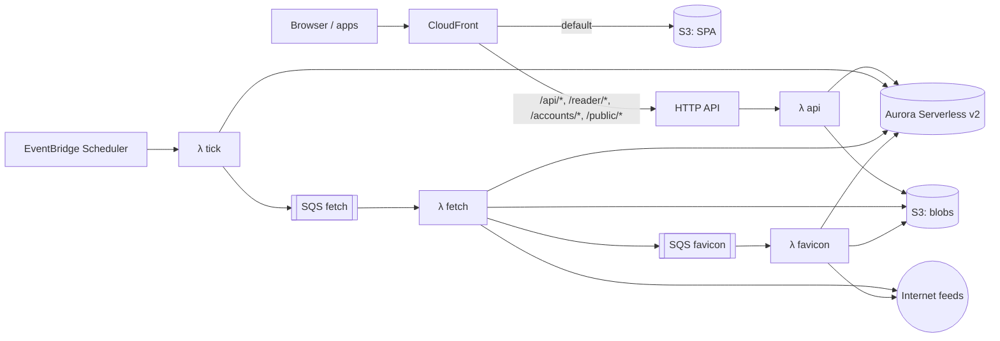

# Architecture

## Stack

| Concern | Choice |
|---|---|
| Language/runtime | TypeScript 6.0 (strict, ESM, erasable syntax only), Node 24 LTS running `.ts` directly via native type stripping (no build step for Node packages), pnpm workspaces |
| HTTP server | Fastify 5, Zod type provider, `@fastify/swagger` (OpenAPI) |
| Database | PostgreSQL 18; Drizzle ORM; drizzle-kit SQL migrations |
| Jobs | pg-boss (Docker), SQS (AWS) |
| HTTP client | undici |
| Feed parsing | `feedsmith` (RSS, Atom, RDF, JSON Feed, OPML); `htmlparser2` for feed autodiscovery |
| Content | sanitize-html; `@mozilla/readability` + linkedom |
| Auth | `@node-rs/argon2`, `otpauth` |
| Logging | Pino (JSON) |
| Web | Vue 3, Vite, Vuetify 3, Pinia, Vue Router, TanStack Vue Query, vue-i18n |
| Desktop | Electron, electron-vite, electron-builder |
| Mobile | Capacitor |
| Tests | Vitest, Testcontainers (Postgres), Playwright, axe-core (WCAG 2.2 AA scans in the Playwright suite) |
| Infrastructure | AWS CDK (TypeScript) |
| CI/CD | CDK Pipelines (CodePipeline + CodeBuild) defined in `infra/`; no GitHub workflows |

## Repository layout

Workspace packages exist only where runtime or toolchain differs.

| Path | Contents |
|---|---|
| `server/` | Server code: Docker image roles and Lambda handlers (Node) |
| `web/` | Vue SPA (PWA), built by Vite |
| `desktop/` | Electron shell around the web build |
| `mobile/` | Capacitor shell around the web build |
| `shared/` | Zod schemas, API types, typed API client (browser and Node) |
| `infra/` | CDK app: stage stacks and per-stage pipelines |
| `docker/` | Dockerfile, `compose.yaml`, `.env.example`, reverse-proxy examples |

`server/src` layers. ESLint enforces the allowed imports.

| Folder | Contents | May import |
|---|---|---|
| `core` | Domain services (feeds, entries, filters, search, auth) and port interfaces; no framework or cloud SDK imports | `db`, `shared` |
| `db` | Drizzle schema and migrations | `shared` |
| `adapters` | Port implementations (pg-boss, local FS, S3, SSE, …) | `core`, `db`, `shared` |
| `api` | Native REST, TTRSS-compatible and Google Reader routes, SSE endpoint | `core`, `db`, `shared` |
| `importer` | TTRSS importer | `core`, `db`, `shared` |
| `entrypoints` | `server`, `worker`, `migrate`, `cli`, and `lambda/` handlers — wire adapters into core | anything |

## Runtime model

- Docker: one container image, role selected by command: `server`, `worker`, `migrate`, `cli`.
- AWS: Lambda handlers `api`, `tick` (dispatch, purge, auth prune), `fetch`, `favicon`, `migrate`, bundled by esbuild; each reads the database password parameter once per cold start.

Rules:
- Server is stateless; sessions live in Postgres.
- No local-disk state outside `BlobStore`.
- Migrations run as a one-shot `migrate` command (on AWS, a function invoked before each deployment's functions update), guarded by a Postgres advisory lock.
- Database connections time out after 10 s and idle transactions after 60 s. The server role also limits statements to 30 s and lock waits to 10 s, so requests fail instead of hanging.
- The server logs a warning, with pool usage and the longest event-loop delay, for responses slower than 2 s and for requests the client abandons before a response.
- `buildApp()` constructs the Fastify app without listening, so it can be mounted by `listen()` or a Lambda adapter.
- The SPA is a standalone static build and talks only to the API.
- Clients treat realtime as optional and poll counters when no stream is available.

### Ports

| Port | Responsibility | Self-hosted | AWS |
|---|---|---|---|
| `JobQueue` | Enqueue and consume jobs with retries; optional dedupe by key | pg-boss | SQS (no dedupe), consumed by Lambda |
| `Scheduler` | Periodically dispatch due feeds and purges | In-process timer in worker | EventBridge Scheduler |
| `BlobStore` | Favicons, cached images | Local volume | S3 |
| `Realtime` | Publish per-user invalidation events from any process; server streams them to clients over SSE | Postgres LISTEN/NOTIFY | None: the stream answers 204 and clients poll |
| `Config` | Settings and secrets | Environment | Environment and SSM Parameter Store |
| `Logger` | Structured logs | Pino | Pino |

## Web app

| Folder (`web/src`) | Contents |
|---|---|
| `views` | Route pages: login, signed-in layout (feed tree drawer, dialogs), reader, settings |
| `components` | Reader (tree, headlines, combined list, article), dialogs, settings panels |
| `composables` | Server state (TanStack Query), live counters, shortcuts, session |
| `lib` | Pure logic: stream keys, tree building, shortcut matching, reordering, cache patches |
| `stores` | Pinia store for UI state only (drawer, dialogs, notices) |

- Routes: `/login`, `/settings/:tab`, `/:stream/:entry?`. Streams are `all`, `fresh`, `starred`, `published`, `read`, `f<subscription>`, `c<category>` (`c0` uncategorised); search is `?q=`.
- Server data lives in the TanStack Query cache. State changes patch every cached copy, then save; a failure restores the previous flags. Headline lists are not refetched when entries change state, so read entries stay in place until the list is reloaded.
- Opening an entry marks it read once. Combined layout can mark entries read as they scroll above the top, saved in one request per second.
- Counters refetch on `counters` events. Without a stream they are polled every 60 s, paused while the page is hidden; a closed stream is retried every 5 minutes.
- Below 900 px one pane shows at a time; below 700 px secondary toolbar actions move into a menu.
- Shortcuts follow TTRSS's defaults, including two-key chords (`g a`) with a 1.5 s window. They are ignored in text fields and while a dialog is open.
- PWA: the service worker precaches the app shell only; API requests always go to the network.
- Every response carries `X-Content-Type-Options: nosniff`; API responses default to `Cache-Control: no-store`. On AWS, CloudFront adds HSTS to API responses too.
- In the Docker image the server serves the build from `WEB_DIR`, with a CSP (scripts from self only, frames from the sanitiser's video hosts), `Referrer-Policy: no-referrer`, and immutable caching of fingerprinted assets. Unknown non-API GETs return `index.html`. On AWS, CloudFront serves the build from S3 with the same headers, and a viewer-request function maps extensionless paths to `index.html`.

## Ingest pipeline

```
Scheduler ─▶ claim due sources ─▶ feed.fetch job per host (≤ 20 sources, fetched one after another)
  fetch      conditional GET (ETag/Last-Modified); per host at most 2 concurrent requests, starts ≥ 1 s apart
  decode     bytes → text; charset from BOM, then HTTP Content-Type, then XML declaration/HTML meta, else UTF-8
  parse      feedsmith → per-format mapping to normalised entries; XML that fails to parse is a fetch error
             dates parsed leniently, zone-less dates are UTC, unparseable dates are null
             entry links, enclosures, and site URLs kept only if absolute http(s)
  identify   feed GUID, else sha256(link + title), else sha256(content); duplicates within a document dropped
  sanitise   allow-list HTML; strip control characters; resolve relative URLs (incl. srcset); titles to plain text
  transform  hook: readability, site rewrites
  store      insert new entries; rewrite existing ones only when their content hash changed; replace enclosures
  fan out    new entries become unread user entries for every subscription, unless older than its purge age
  filter     each subscriber's filters, in order, until "stop"
  notify     Realtime `counters` event per user who received entries
  schedule   next fetch after the interval, or after backoff on failure; favicon refresh when older than 30 days
```

Updater:
- Dispatch claims due sources with `FOR UPDATE SKIP LOCKED`, at most 20 per host, pushing their next fetch 15 minutes out, so concurrent dispatchers never double-fetch. A finished fetch sets the real next time.
- One `feed.fetch` job per host may wait in the queue; sources that cannot join it stay due for the next dispatch.
- The base interval is the shortest among subscribers, each taking the subscription's override, else the user's `updateIntervalMinutes` preference, else `FEED_UPDATE_INTERVAL_MINUTES`; never below 5 minutes. Users and subscriptions cannot set less than 15 minutes.
- The next fetch waits the base interval or the publisher's hint (Cache-Control `max-age`/`Expires`, RSS `ttl`, `sy:updatePeriod`), whichever is longer, hints capped at 24 h, plus up to 10 % random jitter.
- `sort_at` is the published time (fetch time when absent), clamped to now.
- A failed fetch waits interval × 2^(failures − 1), capped at 24 h and never less than `Retry-After`. HTTP 410, or `FEED_DISABLE_AFTER_FAILURES` consecutive failures, disables the source.
- `Retry-After` (and HTTP 429 without it: 10 minutes) sets the source's `blocked_until`. A 429, or a 503 with `Retry-After`, also pauses every source on that host until then (`fetch_hosts`, shared by all processes), without counting failures.
- "Update now" clears errors, re-enables the source, and enqueues a fetch. It is a no-op within a minute of the last fetch and refused (`throttled`) while `blocked_until` is in the future.
- A permanent redirect (301/308 from the first hop on) moves the source to the new URL after a successful fetch, unless another source already has that URL.
- Favicons: declared `<link rel="icon">`/`apple-touch-icon`, else `/favicon.ico`; the first 3 candidates only; page read up to 512 KB, icons up to 256 KB; reused from another source of the same site checked within 30 days instead of refetched; share the per-host limits; stored in `BlobStore`; served with a sandboxing CSP.

Purge (every 6 h):
- Deletes user entries older than the purge age: the subscription's `purge_days`, else the user's `purgeDays` preference, else `FEED_PURGE_DAYS`; 0 never. Starred and published entries are never purged.
- Deletes entries no user references once they have been absent from their feed for 7 days (`last_seen_at`), so purged entries are not re-ingested as new.
- Deletes feed sources with no subscriptions and no kept entries, and their favicons.
- Deletes tombstones older than 30 days, and expired host pauses.

Fetching untrusted URLs (`HttpFetcher`):
- http(s) only, at most 5 redirects, a 20 s timeout, and a 10 MB body limit (lower per request where less is needed); downloads stop once the limit is exceeded. Responses are decompressed.
- Private, loopback, link-local, multicast, documentation, and IPv4-embedding IPv6 (NAT64, 6to4, Teredo) addresses are refused unless allowed by `FETCH_ALLOW_PRIVATE_NETWORKS`. The check runs on the resolved address at connect time, which also covers redirects and DNS rebinding.
- Subscribe errors name the failure class (private network, HTTP status, too large, unreachable), never the network error text.

Subscription lifecycle:
- Subscribing normalises the URL. An existing feed source is reused without fetching. Otherwise the URL is fetched and must parse as a feed, or be an HTML page whose `<link rel="alternate">` names exactly one feed; several feeds are returned for the user to choose.
- Subscribing to a new source ingests the response that validated it, so the feed is not fetched twice. OPML import creates sources and subscriptions only; their entries arrive with the first scheduled fetch. Subscribing to a source that already has entries delivers those within the purge window immediately.
- Unsubscribing deletes the user's entries from that feed except starred and published ones, which stay with no subscription. Feed sources without subscriptions are left for purge.
- Deleting a category moves its feeds and child categories to its parent.
- OPML import reuses categories with the same name and parent, and existing subscriptions, so re-importing is a no-op. It skips TTRSS's `tt-rss-prefs`, `tt-rss-labels`, and `tt-rss-filters` outlines.

Internal hooks: `beforeIngest`, `transformContent`, `afterIngest`, `renderArticle`. Readability, image proxy rewriting, and tracking-pixel stripping are implemented as hook modules.

## Data model

Shared rows are stored once per instance; per-user rows carry `user_id`. Every table synced to clients has `updated_at`, maintained by a database trigger. Statement-level triggers record deletions of categories, subscriptions, and user entries as tombstones for incremental sync.

| Entity | Scope | Notes |
|---|---|---|
| `users` | Instance | Login (unique), Argon2id hash, role (`admin`/`user`), TOTP secret, disabled flag |
| `sessions` | User | Token hash, kind (`cookie`/`bearer`), user agent, last seen, expiry |
| `app_passwords` | User | Name, hash, last used |
| `user_prefs` | User | One row per changed preference (JSON value); unset keys take the defaults in `shared` |
| `categories` | User | Self-referencing tree (`parent_id`), order |
| `feed_sources` | Shared | Unique normalised URL; fetch state (ETag, Last-Modified, next fetch, error count, last error, publisher TTL hint, `blocked_until`); site URL; favicon ref. Fetch interval is the shortest among its subscribers; subscriptions with HTTP-auth credentials get a dedicated source |
| `subscriptions` | User | → feed source, category; title override, interval and purge overrides, per-feed options, encrypted HTTP-auth credentials. Unique (user, feed source) |
| `entries` | Shared | → feed source; GUID, link, title, author, content, content hash, published/updated times, language, `tsvector` (generated, GIN index). Unique (feed source, GUID) |
| `enclosures` | Shared | → entry; URL, MIME type, length, dimensions |
| `user_entries` | User | → entry, subscription (nullable when archived) or archived feed; unread, starred, published, score, note, read time, share UUID. Unique (user, entry) |
| `archived_feeds` | User | Title and URL of an unsubscribed feed that still holds kept entries |
| `labels` / `entry_labels` | User | Caption, colours; many-to-many with `user_entries` |
| `tags` | User | (user entry, tag) pairs |
| `filters` / `filter_rules` / `filter_actions` | User | Ordered filters; match any/all, inverse, enabled; rules: field (title, content, title-or-content, author, link, tag), regex, inverse, scope (feeds/categories); actions: type + parameter |
| `access_keys` | User | Secret keys for published feed and generated feeds |
| `import_map` | Instance | (source system, source table, source id) → new id |

Key indexes:
- `user_entries (user_id, unread)`, partial indexes on `starred` and `published`.
- `user_entries (subscription_id, …)` for feed views.
- `entries (feed_source_id, published_at DESC)`.

Headline lists use keyset pagination on (sort key, id). `user_entries.sort_at` is a denormalised copy of the entry's published time (fetch time when absent), so every headline view is served by one index. Descending index columns are `NULLS LAST`; queries order the same way so the indexes apply.

Search:
- A generated `tsvector` (`simple` configuration, markup stripped) on `entries`; queries use `websearch_to_tsquery` (quotes, `OR`, `-`).
- A query matching at most 20,000 entries instance-wide (counted from the GIN index) is resolved into a materialised set of the user's matches, then sorted. A more common one walks the headline index, where matches are dense.
- Relevance order ranks (`ts_rank`) the 1,000 most recent matches and pages by offset.

## Authentication

| Client | Credential | Notes |
|---|---|---|
| Web | httpOnly, SameSite=Lax session cookie | CSRF token on state-changing requests; TOTP at login when enabled |
| Electron / Capacitor | Bearer session token | Stored in OS secure storage (Electron `safeStorage`, platform keystore on mobile) |
| TTRSS / Google Reader clients | App password → API session | App passwords bypass TOTP |

- Session tokens are 256-bit random values stored as SHA-256 hashes. Cookie sessions last 30 days and bearer sessions 90 days, both sliding on use.
- Cookie-session requests other than GET/HEAD/OPTIONS must send the session's CSRF token in `X-CSRF-Token`. Login accepts JSON only, so cross-site form posts cannot log a browser in.
- Failed logins are counted in `login_attempts` per account (lockout after 5) and per IP (after 20). Lockouts start at 1 s and double per further failure, up to 15 minutes. A wrong current password when changing it counts against the account.
- Passwords are 8–1,024 characters and not on the bundled common-password list (`shared/src/common-passwords.ts`).
- Logins, failures, lockouts, CSRF rejections, password changes, session revocations, and admin user changes are logged with a `security` field naming the event. The logger redacts credentials and auth headers.
- Changing or resetting a password, or disabling a user, revokes their other sessions. The last active admin cannot be demoted, disabled, or deleted.

## APIs

| Surface | Path | Notes |
|---|---|---|
| Native REST | `/api/v1/*` | OpenAPI at `/api/v1/openapi.json`; typed client in `shared` |
| Events | `/api/v1/events` | SSE: `counters` invalidation events |
| Public | `/public/*` | Published feeds and share links (no auth, secret key/UUID) |
| TTRSS-compatible | `/api/` (POST JSON `op`) | See below |
| Google Reader | `/accounts/ClientLogin`, `/reader/api/0/*` | See below |

### Native REST API

- Entries are identified by `user_entries.id`. A headline list selects one stream: a subscription, a category (with subcategories; `0` is uncategorised), or a special feed (`all`, `fresh`, `starred`, `published`, `recentlyRead`).
- Fresh: unread entries with `sort_at` within the user's `freshMaxAgeHours`. Recently read: entries read within the last 7 days, in reading order.
- `adaptive` view resolves to `unread` when the stream has unread entries, else `all`; the cursor carries the resolved view.
- State changes and catch-up publish `counters`; rows already in the requested state are not updated.
- `GET /sync` returns categories, subscriptions, and entries (without content) changed since a token, and deleted ids. Each call only covers changes before the start of the oldest transaction still open in the database, so rows committed late are never skipped. Entries page by (`updated_at`, id); `more` asks for another call. Tokens older than the 30-day tombstone retention get `410 resync_required`.

Events stream:
- Events are per-user invalidation signals; clients refetch what they describe. Events of one type within 1 s are sent once.
- `X-Accel-Buffering: no` disables nginx buffering; a comment line every 25 s keeps proxies from timing out; streams end after 30 minutes and clients reconnect, which re-checks the session.

### TTRSS-compatible API

- Operations: `login`, `logout`, `isLoggedIn`, `getApiLevel`, `getVersion`, `getUnread`, `getCounters`, `getFeeds`, `getCategories`, `getFeedTree`, `getHeadlines`, `getArticle`, `updateArticle`, `catchupFeed`, `updateFeed`, `getConfig`, `getPref`, `getLabels`, `setArticleLabel`, `shareToPublished`, `subscribeToFeed`, `unsubscribeFeed`.
- Special feed IDs:
  - `-1` starred
  - `-2` published
  - `-3` fresh
  - `-4` all
  - `-6` recently read
  - `0` archived
- Labels are exposed as feed ID `-1025 - label_id`.
- `sid` maps to an API session; login accepts app passwords only.

### Google Reader API

- Auth: `ClientLogin` with app password → `Auth` token; `/reader/api/0/token` for write tokens.
- Endpoints:
  - `user-info`, `subscription/list`, `subscription/edit`, `subscription/quickadd`, `subscription/export`
  - `tag/list`, `unread-count`
  - `stream/contents`, `stream/items/ids`, `stream/items/contents`
  - `edit-tag`, `rename-tag`, `disable-tag`, `mark-all-as-read`
- Item IDs: long form `tag:google.com,2005:reader/item/<16 hex>` and decimal short form, both derived from `user_entries` ID.
- Streams:
  - `user/-/state/com.google/reading-list`
  - `user/-/state/com.google/starred`
  - `user/-/state/com.google/read`
  - `user/-/label/<category or label>`
  - `feed/<url>`

## Deployment

### Self-hosted

`docker/compose.yaml`:

| Service | Image | Notes |
|---|---|---|
| `db` | `postgres:18-alpine` | Named volume |
| `migrate` | app image, `migrate` | Runs to completion before `server`/`worker` start |
| `server` | app image, `server` | Serves API and SPA; behind the user's reverse proxy for TLS; `/healthz` checks database and queue |
| `worker` | app image, `worker` | Jobs and scheduler |
| `backup` (`backup` profile) | `postgres:18-alpine` | Nightly `pg_dump` to a volume |

### AWS



- Stacks per stage: `Params` (generated credentials), `Data` (VPC with public subnets only, Aurora, blob bucket), `App` (functions, HTTP API, queues with dead-letter queues, schedules, migrate trigger), `Edge` (CloudFront, SPA bucket, DNS records), all in us-east-2. CloudFront uses the existing `*.example.com` certificate in us-east-1, imported by ARN.
- Names: stacks are `rss-reader-<stage>-{params,data,app,edge,pipeline}`, and resources with settable names use `rss-reader-<stage>-<role>` (functions, log groups, queues, schedules, HTTP API, cluster, CloudFront function and policies). Bucket names are generated from the stack name. Everything is tagged `project=rss-reader` and `stage=<stage>`.
- Functions run outside any VPC, so they reach feeds without NAT. Aurora is publicly reachable on 5432 with TLS required (`rds.force_ssl`) and a generated password; it scales between 0 and 2 ACU and pauses after 5 idle minutes.
- Dispatch runs every 30 minutes; purge (every 6 h) and auth prune (hourly) fall on dispatch times, so the database wakes once per slot. One fetch invocation handles one host's batch; at most 8 run at once.
- CloudFront adds a secret `x-origin-verify` header to API requests; the API refuses requests without it.
- Generated credentials are Standard SSM parameters under `/rss-reader/<stage>/`, created once by a custom resource in `Params` and deleted with it; `Params` deploys before `Data` because change sets resolve `ssm-secure` references: `db-password` and `admin-password` (SecureString), `origin-header` (String, because CloudFront resolves only String parameters). `TRUST_PROXY` is two hops (API Gateway appends CloudFront's address after the viewer's).
- The SPA bucket is private, accessed via Origin Access Control. `assets/` is cached as immutable; other files are revalidated, and each deployment invalidates the distribution.
- Logs go to CloudWatch, kept a month.
- Web traffic is same-origin through CloudFront. CORS allows Capacitor origins only.

Constraints:
- The first request after the database pauses waits about 15 s for it to resume.
- Responses are capped at 6 MB; list pages with content end early past 2 M content characters.
- No SSE; clients poll counters every 60 s.

Operator setup, once per account:
- `pnpm --filter @rss-reader/infra cdk bootstrap aws://123456789012/us-east-2`
- `pnpm --filter @rss-reader/infra cdk deploy rss-reader-dev-pipeline` (and `rss-reader-prod-pipeline`); a new pipeline runs once on creation, and later changes deploy through it.
- The first admin is `admin`, with the password in the SSM SecureString `/rss-reader/<stage>/admin-password`.
