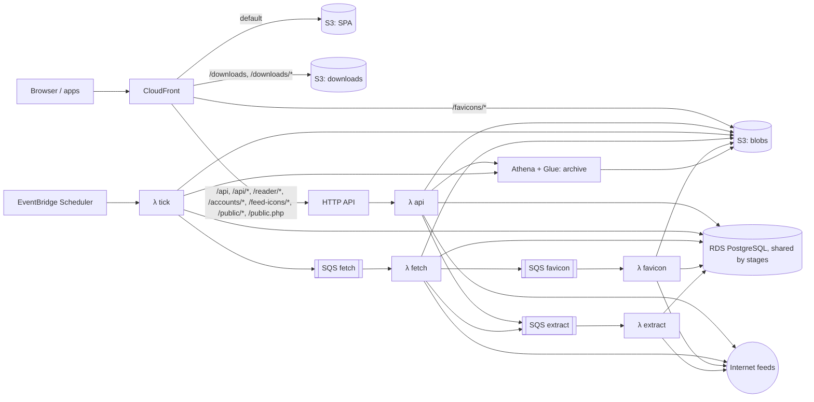

# Architecture

## Stack

| Concern | Choice |
|---|---|
| Language/runtime | TypeScript 6.0 (strict, ESM, erasable syntax only), Node 24 LTS running `.ts` directly via native type stripping (no build step for Node packages), pnpm workspaces |
| HTTP server | Fastify 5, Zod type provider, `@fastify/swagger` (OpenAPI) |
| Database | PostgreSQL 18; Drizzle ORM; drizzle-kit SQL migrations |
| Jobs | pg-boss (Docker), SQS (AWS) |
| HTTP client | undici |
| Feed parsing | `feedsmith` (RSS, Atom, RDF, JSON Feed, OPML); `htmlparser2` for feed autodiscovery |
| Content | sanitize-html; `@mozilla/readability` + linkedom |
| Auth | `@node-rs/argon2`, `otpauth` |
| Logging | Pino (JSON), with the active trace's ids |
| Observability | OpenTelemetry API and Node SDK (OTLP); `@fastify/otel`, pg-boss's built-in tracing, pg and Node runtime instrumentation; nodemailer for alert email. AWS: ADOT Lambda layer to X-Ray, SNS, AWS Budgets |
| Web | Vue 3, Vite, Vuetify 3, Pinia, Vue Router, TanStack Vue Query, vue-i18n |
| Desktop | Electron, esbuild, electron-builder |
| Mobile | Capacitor (Android) |
| Tests | Vitest, Testcontainers (Postgres), Playwright, axe-core (WCAG 2.2 AA scans in the Playwright suite) |
| Infrastructure | AWS CDK (TypeScript) |
| CI/CD | CDK Pipelines (CodePipeline + CodeBuild) defined in `infra/`; no GitHub workflows |

## Repository layout

Workspace packages exist only where runtime or toolchain differs.

| Path | Contents |
|---|---|
| `server/` | Server code: Docker image roles and Lambda handlers (Node) |
| `web/` | Vue SPA (PWA), built by Vite |
| `desktop/` | Electron shell around the web build |
| `mobile/` | Capacitor shell around the web build |
| `shared/` | Zod schemas, API types, typed API client (browser and Node) |
| `infra/` | CDK app: stage stacks, per-stage deploy and release pipelines, release buildspecs |
| `docker/` | Dockerfile, `compose.yaml`, `.env.example`, reverse-proxy examples |

`server/src` layers. ESLint enforces the allowed imports.

| Folder | Contents | May import |
|---|---|---|
| `core` | Domain services (feeds, entries, filters, search, auth) and port interfaces; no framework or cloud SDK imports | `db`, `shared` |
| `db` | Drizzle schema and migrations | `shared` |
| `adapters` | Port implementations (pg-boss, local FS, S3, SSE, SMTP, instrumented fetcher, …) | `core`, `db`, `shared`, `telemetry` |
| `api` | Native REST, TTRSS-compatible and Google Reader routes, SSE endpoint | `core`, `db`, `shared`, `telemetry` |
| `telemetry` | OpenTelemetry helpers, instruments, SDK preload, Fastify tracing | `shared` |
| `importer` | TTRSS importer | `core`, `db`, `shared` |
| `entrypoints` | `server`, `worker`, `migrate`, `cli`, and `lambda/` handlers — wire adapters into core | anything |

## Runtime model

- Docker: one container image, role selected by command: `server`, `worker`, `migrate`, `cli`.
- AWS: Lambda handlers `api`, `tick` (dispatch, purge, auth prune, archive compaction), `fetch`, `favicon`, `extract`, `migrate`, bundled by esbuild; each reads the database password parameter once per cold start.

Rules:
- Server is stateless; sessions live in Postgres.
- No local-disk state outside `BlobStore`.
- Migrations run as a one-shot `migrate` command (on AWS, a function invoked before each deployment's functions update), guarded by a Postgres advisory lock.
- Database connections time out after 10 s and idle transactions after 60 s. The server role also limits statements to 30 s and lock waits to 10 s, so requests fail instead of hanging.
- The server logs a warning, with pool usage and the longest event-loop delay, for responses slower than 2 s and for requests the client abandons before a response.
- `buildApp()` constructs the Fastify app without listening, so it can be mounted by `listen()` or a Lambda adapter.
- The SPA is a standalone static build and talks only to the API.
- Clients treat realtime as optional and poll counters when no stream is available.

### Ports

| Port | Responsibility | Self-hosted | AWS |
|---|---|---|---|
| `JobQueue` | Enqueue and consume jobs with retries; optional dedupe by key | pg-boss | SQS (no dedupe), consumed by Lambda |
| `Scheduler` | Periodically dispatch due feeds and purges | In-process timer in worker | EventBridge Scheduler |
| `BlobStore` | Favicons, cached images, archive files | Local volume | S3 |
| `ArchiveWriter` | Write entries to the cold-storage archive | Parquet through `BlobStore` | Parquet through `BlobStore`, catalogued in Glue for Athena |
| `ArchiveReader` | List, search, and get archived articles; compact the archive | DuckDB in-process, over the local blob directory | Athena over the Glue table |
| `Realtime` | Publish per-user invalidation events from any process; server streams them to clients over SSE | Postgres LISTEN/NOTIFY | None: the stream answers 204 and clients poll |
| `Config` | Settings and secrets | Environment | Environment and SSM Parameter Store |
| `Logger` | Structured logs | Pino | Pino |
| `Notifier` | Tell operators when alerts open or resolve | Email over SMTP, when configured | The stage's SNS alert topic |

## Web app

| Folder (`web/src`) | Contents |
|---|---|
| `views` | Route pages: login, signed-in layout (feed tree drawer, dialogs), reader, archive, settings |
| `components` | Reader (tree, headlines, combined list, article), dialogs, settings panels |
| `composables` | Server state (TanStack Query), live counters, shortcuts, session |
| `lib` | Pure logic: stream keys, tree building, shortcut matching, reordering, cache patches |
| `offline` | Connectivity, and the per-account local store (IndexedDB through Dexie) |
| `platform` | Platform bridge and the apps' server and token |
| `stores` | Pinia store for UI state only (drawer, dialogs, notices) |

- Routes: `/connect` (apps only), `/login`, `/settings/:tab`, `/:stream/:entry?`, `/:stream/archive/:key?` (`all` or a subscription), and `/publish?url=&title=&text=`, `/subscribe?url=`, and `/share?title=&text=&url=`, which fill in the Publish or Subscribe dialog, or offer the shared page to subscribe to or publish (its address is the first one in `text` or `url`), then show All articles; they never act on their own. The Settings → Sharing bookmarklets open the first two for the current page (its title and up to 2,000 characters of selected text) in a small window from the server's origin, which closes once the page is published. Streams are `all`, `fresh`, `starred`, `published`, `read`, `f<subscription>`, `c<category>` (`c0` uncategorised), `l<label>`, `t<tag>` (URL-encoded); search is `?q=`.
- The archive view lists past articles read-only. Star, Publish, Labels, and Add note restore the article (the last two read, then open their dialog on it) and open it in its feed. It is reached from a subscription's or All articles' toolbar, and from a search, which it repeats over the archive.
- Server data lives in the TanStack Query cache. Article changes (flags, score, catch-up, note, labels, tags) patch every cached copy, then save; a refusal restores the previous values. Without offline reading, a failure to reach the server does too. Headline lists are not refetched when entries change state, so read entries stay in place until the list is reloaded.
- With offline reading on, headline lists, entries, and the snapshot queries fall back to the store when the server cannot be reached, and without a network do not ask it. Stored lists follow the server's stream rules (subcategories, Fresh window, low scores hidden where the server hides them, feeds hidden from All) and page by offset. Without the server, search covers the store: titles, authors, and feed names of stored entries and their stored text (HTML stripped), as words folded to lower case without accents, CJK as character pairs, in multi-entry `words` indexes on `entries` and `contents`; every word must match, the last as a prefix, newest first. Content is indexed as it downloads, older content in batches after a sync; the index counts toward the storage limit, and settings show its size. A stored entry whose content is its latest version opens without a request.
- Connectivity is online, offline (the shell reports no network), or unreachable: a request failed at the network, took over 45 s to answer, or got 502–504. Any other answer makes it online. While unreachable, `GET /server` checks again after 5 s, backing off to once a minute, and at once when the network returns or the app resumes. Queries pause and are not retried unless online; the first session check still runs, so the app can say the server is unreachable, and it reloads once the server answers.
- The local store is one IndexedDB database per account (`newses-<user>`, in the apps `newses-<server hash>-<user>`); `localStorage` remembers the last account, and in the apps each profile's, with the profile's offline settings and last theme. In the browser, signing out or another user signing in deletes the previous account's store; in the apps a profile keeps its store while the app runs on another, and signing out deletes it. When the server ends a session without a sign-out here (a 401, found by the page, the service worker, or the Android job), what a reader could see goes: the store keeps only changes not yet sent, which the same user sends after signing in again, when it downloads again; with none, it is deleted too.
- Offline reading is on in the apps, and in a browser once turned on for the device. Against API 1.1 or later the app keeps the store current. The first sync takes `/sync/token`, then the unread (up to the device's setting: 1,000, 5,000, or 10,000; All's first, then each feed hidden from All), starred (2,000), and Recently read (2,000) headlines, the lists, preferences, themes, counters, tags, and the session without its CSRF token; later syncs follow `/sync`, and a `410`, or keeping more unread entries, loads everything again. Syncs run at launch, on resume, when the server answers again, when counters change, and every 15 min (30 while hidden, then only where counters are polled in the background); one tab runs them at a time.
- The store keeps unread and starred entries and those read in the last 7 days; past each limit the oldest go, and content and images no other stored entry shows go with it.
- After each sync, the content of stored entries without a current copy (unread newest first, then starred, then recently read) downloads 100 at a time through `POST /entries/contents`, then their images through the image proxy: two at a time, one per image host, up to 4 MB each in 60 s, failures retried after 24 h, and on Android only on Wi-Fi unless set otherwise. Content and images together stay under the device's limit (256 MB, 1 GB, or 4 GB; in the apps per profile, 1 GB for the first and 256 MB for later ones); past it, images and then text of the lowest-priority entries go. In the apps, Settings → Account shows what each profile's store takes and removes its downloaded data; Offline settings shows all profiles' total from the storage estimate and warns when their limits together pass the quota; the apps ask for persistent storage at launch.
- Stored images show from the device, online too, matched by their original URL whether or not the content was proxied; an entry's content renders once they are looked up or after 1.5 s (those found later then replace the others), and without a connection its other images have no source. Without offline reading, opening or scrolling past entries offline does not mark them read. Stored content is served to readers who proxy images with every image at its proxy path, and without the ones that have none.
- With offline reading on, article changes made while the server cannot be reached, before the session is confirmed, or behind changes already waiting go to the store's outbox and the stored entries; counters are adjusted as the server will count them. Waiting changes are merged per entry and flag, keeping each catch-up in its place; an offline catch-up applies to the stored entries and is sent with the newest stored id as `maxId`. Each change records what the entry had before it. Each sync first sends them, oldest first, equal flag changes in bulk `PATCH /entries` (up to 1,000). Against API 1.2 they are compare-and-set: flags carry `expect`, labels and tags go as added and removed, and notes carry `expected`; changes the server kept for newer values are counted for the reader, and a note changed elsewhere too asks the reader to keep their own, keep the server's, or copy their own and keep the server's. Older servers have changes replaced as they are. A failure to reach the server retries after 2 s, doubling to 5 min; a 429 waits for `Retry-After`; a 401 waits for sign-in; a 404 drops the change, except labels, sent again without the labels that are gone; other refusals drop it and tell the reader. Entries from the server, synced or listed, show the changes still waiting for them. Signing out with changes waiting asks first.
- Preferences, categories (create, rename, move, collapse, delete), feeds (subscribe, rename, move, settings, unsubscribe), labels, and themes (create, edit, publish, delete, import) change offline the same way, shown at once in the cached lists, which show waiting changes over both the server's and the store's copies. Objects created offline get negative ids; once the server creates one, waiting changes, stored entries' labels, and the `appearanceTheme` preference take its id. Deleting one before it is sent forgets it and the changes to it: its feeds and subcategories go to its parent, entries lose the label, a theme in use falls back to Original. A refused create does the same and tells the reader; a page offering several feeds asks to subscribe again; a theme name taken meanwhile gets a number, a label caption taken meanwhile means that label, and a refused theme stays as a draft in Appearance to export. Feeds and categories not yet sent are marked in the tree, labels and themes in their settings; a feed opens once subscribed. Fetching feeds, OPML, filters, sharing, and account settings need the server.
- A status in the corner (`role="status"`) says when the app is offline or the server unreachable, with the changes waiting and the last sync; while online, that changes are being sent, and briefly that the connection is back. Share, full-text extraction (stored full text still shows), and the archive say they need a connection when used offline and are marked `aria-disabled`.
- The Offline settings tab holds the device's choices (unread entries kept, images, Wi-Fi only on Android, storage limit, sync while closed) in `localStorage`, what the store holds, changes waiting, the last sync and its error, Sync now, and Clear, which deletes the store and downloads it again. In a browser a switch turns offline reading on for the device, asking the browser to keep the storage, and off, which deletes the store; it says whether the browser keeps the storage and, in Safari on iOS, to add the app to the Home Screen. Synced changes patch cached lists and entries, and headline pages loaded online are written to the store.
- The snapshot queries (session, preferences, subscriptions, categories, labels, counters, tags, themes) are copied to the store whenever they load, and the first sync writes them before any headlines; the session is also written once the route guard knows the account. When the server cannot be reached, the app starts from them, seeded as stale; once it answers, the session is checked again, and a 401 signs out.
- Entries scored above the user's `scoreHighlightAbove` get a highlight bar and a bold score.
- Opening an entry marks it read once. Combined layout can mark entries read as they scroll above the top, saved in one request per second.
- Counters refetch on `counters` events. Without a stream they are polled every 60 s, paused while the page is hidden; a closed stream is retried every 5 minutes.
- Below 900 px one pane shows at a time; below 700 px secondary toolbar actions move into a menu.
- A theme is a set of tokens (`shared/src/themes.ts`): style, light and dark palettes, UI and article fonts as keys, UI text scale, corners, density, borders, shadows, and effects. Built-in themes are in `shared`; the `appearanceTheme` preference names one, or a custom theme's id, and `themeAdjustments` holds the reader's partial overrides. The `theme` preference is the mode: light, dark, or the system's.
- A theme resolves as its built-in base, then its overrides, then the reader's adjustments; a reference that no longer resolves shows Original. The result replaces the colours of Vuetify's `light` and `dark` themes in place, provides Vuetify defaults around the routes, and sets `--v-font-body`, `--ui-font-scale`, `data-theme-style`, and `data-effects` on the document root.
- The Terminal and Sketch styles are stylesheets in `web/src/themes/`, unlayered so they override Vuetify's layers, scoped by `data-theme-style`, and aimed at app-owned classes where possible. Decorations are generated content with empty alternative text. `data-effects` turns on textures and animation; animation stops under reduced motion and effects under forced colours. Sketch's lines wobble through an SVG filter on frame pseudo-elements, never on text or list rows.
- Palette contrast checks (built-in theme tests, and warnings while adjusting) count text as secondary text shows it, faded to Vuetify's medium emphasis.
- Custom themes export as JSON `{ format: 'newses-theme', version: 1, name, base, tokens }`; importing posts the file's theme to `/themes`, so the server validates it, and numbers a name already taken.
- The last resolved tokens are kept in `localStorage` and applied before mounting, so a reload starts with the reader's theme and signed-out screens use it.
- Reading preferences (font, text size, line width) set CSS custom properties on the document root that article styles read; the `default` font is the theme's article font, and the text size is kept under the theme's scale.
- Fonts are system font stacks, except the theme fonts Patrick Hand and IBM Plex Mono (latin subsets), which are bundled and served from the app's own origin. A browser downloads one only when text uses it; the service worker caches fonts when first used rather than precaching them, and with offline reading on, the first sync of a page loads all of them so themes render offline.
- Shortcuts follow TTRSS's defaults, including two-key chords (`g a`) with a 1.5 s window. They are ignored in text fields and while a dialog is open.
- The `shortcutBindings` preference holds only changed actions; each replaces that action's defaults, and `[]` unbinds it. A key cannot be bound alone while it starts a chord.
- PWA: the manifest's `share_target` (GET `/share`) puts installed apps in the system share sheet. The service worker (`web/src/worker/sw.ts`, Workbox `injectManifest`) precaches the app shell only; API requests always go to the network. Feed icons (`/favicons/*`) are cached when first shown (up to 500), so they show offline; signing out or the session ending deletes them. It is checked with the worker's globals (`web/src/worker/tsconfig.json`), so the offline modules it runs import neither Vue nor the DOM.
- With offline reading on, installed Chrome and Edge apps sync with no window open: Periodic Background Sync (`newses-sync`, at least 30 min, when the browser grants it to the installed app) sends waiting changes, follows `/sync`, and downloads text; Background Sync (`newses-outbox`, registered when a change is kept) sends waiting changes when the connection returns. The page hands the worker the account's store and the device's choices in a small `newses-worker` database, as it has no `localStorage`; it confirms the session (and gets the CSRF token) first, and when it has ended clears what a reader could see and stops until a page signs in again. What it could not send is reported by the next page that opens. Tabs and the worker share the Web Locks, so only one syncs. Other browsers sync while the app is open, and the Offline settings say which applies.

Native build (`build:native`, `web/dist-native`), bundled by the desktop and mobile apps:
- No service worker. `NATIVE_CSP` (`shared/src/web-csp.ts`) is in a `<meta>`: `WEB_CSP` with `connect-src https:`, because the server is chosen at runtime.
- The shells set `window.rssReaderBridge` (`web/src/platform/bridge.ts`) before the app's scripts run: server profiles (a server and a user each, one active) with each profile's bearer token in secure storage, open in the system browser, save a file, notify, app version, update status, network status (and on Android whether it is Wi-Fi), and refresh requests (resume, unlock, the tray; Android's return to the foreground). An update that is ready or available prompts once per version per launch; settings shows the version, the update status, and Check for updates. The web build uses a browser stand-in; the native build outside a shell keeps profiles and tokens in memory.
- Profiles are named by the reader's label, else `login @ server`: the server's instance name, kept with each of its profiles and updated when the app checks the server at launch, or else its host, with an initial on a colour from the profile's id. A profile menu at the top of the drawer, and "Use another profile" on the sign-in page and the unreachable-server screen, lists them (signed-out ones marked) to switch to, and opens the connect screen to add a server. Settings → Account lists them to switch to, rename, or remove; removing asks first, saying how many changes not yet sent are lost, then deletes its store and settings and revokes its session. Sign-in fills in the profile's login.
- The connect screen ("Add a server" once a profile exists) opens on first run, from "Add server", and from "Change server" while there is one profile (sign-in page, unreachable server). It takes an HTTPS origin and checks `GET /api/v1/server`: another product or API major is refused, an older minor warned about. Another server moves the app to that server's profile, a signed-in one first, or to a new one; the profile left keeps its session and store. Moving to another profile waits for a sync or send in progress, stores what the Android job fetched, stops background sync, then reloads the app on the new profile.
- Sign-in asks for a bearer token, which the bridge keeps for the active profile; the login request carries no token, so it ends no other profile's session. Signing in as another user than the profile's moves the app to that user's profile on the server, made if needed, and the profile left stays signed out. Any 401 forgets the token and returns to sign-in; signing out revokes the session, then forgets it.
- Feed icons load from `iconUrl` on the server. A server before API 1.3 gives an `iconUrl` that needs the session, which an `` cannot send, so against one they load from the user's `iconsPath` (login and session responses; the signed `/feed-icons` path).
- Against a server before API 1.4 the feed dialog leaves out Pause updates, Hide from All articles, and the check interval.
- Server-relative URLs in entry content (proxied images, links) are made absolute against the server; public page links use the server's origin.
- The counters stream is read with `fetch`, which can send the token; 204 or an error falls back to polling, and an ended stream reconnects after 5 s.
- OPML export saves through the bridge. Links to other origins open in the system browser and never navigate the app.
- Every response carries `X-Content-Type-Options: nosniff`, and HSTS (1 year) when the request arrived over HTTPS; API responses default to `Cache-Control: no-store`. On AWS, CloudFront also adds HSTS to every response and a viewer-response function adds `charset=utf-8` to text responses from S3.
- In the Docker image the server serves the build from `WEB_DIR`, with a CSP (scripts from self only, frames from the sanitiser's video hosts), `Referrer-Policy: no-referrer`, and immutable caching of fingerprinted assets. Unknown non-API GETs return `index.html`. On AWS, CloudFront serves the build from S3 with the same headers, and a viewer-request function maps extensionless paths to `index.html`.

## Desktop app

`desktop/`: Electron for Windows and Linux (x64). esbuild bundles the main process and preload into `out/`, beside the native web build (`out/web`); electron-builder packages a per-user NSIS installer, a zip of the app (runs without installing; not updated by electron-updater), a portable exe, an AppImage, and a deb.

- The web build is served from `app://newses`, a privileged standard scheme: client-side routes fall back to `index.html`, and responses carry the native CSP as a header. The API sees that origin.
- The window has context isolation, the sandbox, no Node integration, and no webviews. New windows are denied and navigation away from the app is blocked; http(s) links open in the system browser. Only the notification and clipboard-write permissions are granted.
- Fuses: no `RunAsNode`, `NODE_OPTIONS`, or inspect arguments; the app loads only from its integrity-checked asar.
- The preload exposes the bridge; the main process answers only frames on the app origin and validates arguments.
- The app's theme preference sets Electron's theme source: `system` follows the OS (`prefers-color-scheme`), light and dark pin it. The window's background follows the appearance theme's, and the last one is kept in settings so a new window opens in it.
- No native title bar: the app bar moves the window (an empty strip at the top on screens without one), and the window controls overlay its end (Window Controls Overlay, transparent), drawn in the appearance theme's text colour, also kept in settings. Open overlays and the narrow layout's drawer turn the drag area off.
- `settings.json` in the user data folder (owner-only) holds the profiles, the active one, window bounds, and each profile's token encrypted with `safeStorage` (DPAPI on Windows, the keyring on Linux). On Linux without a keyring (`basic_text`) tokens are kept in memory only, so each launch signs in.
- Portable exe (`portable` target): unpacks the app into a new temporary folder on each launch (`unpackDirName: false`) and deletes it on exit. With `PORTABLE_EXECUTABLE_DIR` set, the app moves `userData` (settings, the offline store, Chromium's data) to `Newses Data` beside the exe before taking the single-instance lock, or keeps the default when that folder cannot be written. On another PC or Windows user, DPAPI cannot decrypt the tokens, so each profile signs in again.
- One instance at a time. Closing saves the window bounds unless the window is minimized or off every screen; they are restored while still on a screen, else the window opens centred on the primary screen. The menu (File, Edit, View) has no bar; its shortcuts work.
- WSLg places Linux windows itself, ignoring the bounds the app asks for, and does not report Windows-side moves or minimizing to the app. A window closed while minimized there reopens minimized and off-screen.
- New entries: while the window is hidden or unfocused, the main process shows one notification of the unread entries added to existing subscriptions since it went there ("12 new entries": the categories, most first). The first shows at once; it is then replaced with the running total, when that has grown, at most every 15 min, and closed when the window is focused. Clicking it opens the feed or category, or All; after a move to another profile it only shows the window. Hidden windows poll counters every 30 min (the AWS dispatch interval) instead of pausing; resume, unlock, and the tray's Check now refresh at once. Notifications can be turned off.
- Optional, in settings: keep running in the tray when the window closes (Open, Check now, with several profiles a Profiles submenu marking the active one, Quit; picking another shows the window and moves the app there), and start at login (`--hidden`, straight to the tray when it is on; a login item on Windows, an XDG autostart entry on Linux; not offered by the portable exe). Desktop options live in `settings.json`.
- Updates (release builds only; electron-updater on the stage's `/downloads` feed): checked at launch and every 6 h. AppImages and signed NSIS installs (uninstaller beside the exe, publisher in the feed config) download in the background and install on restart or quit; updates must carry the same Windows publisher. A deb, the Windows zip, or the portable exe gets a link to the downloads page instead. Prereleases update to newer prereleases (semver order).
- `pnpm dev` serves `app://newses` from the web app's Vite dev server in native mode, so the origin and bridge match the packaged app.

## Mobile app

`mobile/`: Capacitor for Android, `app.newses`, served from `https://localhost`. `android/` is committed.

- `build` assembles `www/` from the native web build and `bridge.js` (the bridge bundled with the Capacitor plugins), loaded before the app's scripts, then syncs it into `android/`.
- Bridge: the profiles in Preferences; each profile's token in secure storage (AES-GCM with an Android Keystore key); links in Custom Tabs; files saved to the cache and offered through the share sheet; status and navigation bar icons are light over a dark theme background, judged by its luminance rather than the mode.
- Background sync: the app's `BackgroundSync` plugin runs a WorkManager job every 30 min, needing a network (unmetered with images on Wi-Fi only) and a battery that is not low. It follows `/sync` from the store's token (at most 20 pages), then fetches the text of unread and starred entries that changed, keeping each response in app storage (at most 8 MB), tagged with the profile, without sending waiting changes. It runs for the active profile only: the bridge hands it that profile's id, server, and bearer token, which it keeps encrypted with its own Keystore key. On launch and resume the web app takes the pages fetched for the active profile, dropping any other's, and stores them in order, a sync page only when it carries on from the store's token, then hands over its token after each sync; a 401 stops the job until sign-in and deletes what it kept, and turning it off, signing out, Clear, offline reading off, leaving the profile, or another profile taking it over deletes what it kept.
- The back button closes the top dialog or menu, then the drawer, then goes back; at the start of the app's history it exits.
- The app draws edge to edge (the native build's viewport has `viewport-fit=cover`): `#app` is inset by the safe areas (Capacitor's `--safe-area-inset-*` variables, else `env()`) and contains the layout, which scrolls inside it.
- HTTPS only (cleartext off), the permissions are `INTERNET` and `ACCESS_NETWORK_STATE` (and those WorkManager adds: wake lock, boot completed, foreground service), and app data is not backed up (Keystore keys do not move between devices).
- Share to the app: an `ACTION_SEND` `text/plain` filter on the `singleTask` activity; the app's `ShareTarget` plugin passes the text and its subject to the bridge (also for a share that launches the app). The first http(s) URL, titled by the subject or else the rest of the text, is offered to subscribe to or publish, after sign-in when signed out; servers before API 1.5 open the subscribe dialog filled in. The page goes to the active profile; with others signed in, the dialog names it and can move the page to another, kept in `sessionStorage` across the reload.
- Updates (release builds only): at launch, at most daily, the bridge fetches the stage's `/downloads/latest.json` natively (no CORS) and compares its `versionCode`; a newer APK opens in the browser, which hands it to the package installer. The last result is kept between launches.
- `versionName` comes from the release tag and `versionCode` is major·1000000 + minor·10000 + patch·100 + a prerelease slot: `-rc.N` (1–98) is N, a release 99, a `try-release.sh` build (`-try.*`) 0; other prerelease tags are refused. Local builds are `0.0.0-dev` (code 1). Release APKs are signed with the release keystore when `ANDROID_KEYSTORE_*` is set, else unsigned.

## Ingest pipeline

```
Scheduler ─▶ claim due sources ─▶ feed.fetch job per host (≤ 20 sources, fetched one after another)
  fetch      conditional GET (ETag/Last-Modified); per host at most 2 concurrent requests, starts ≥ 1 s apart
  decode     bytes → text; charset from BOM, then HTTP Content-Type, then XML declaration/HTML meta, else UTF-8
  parse      feedsmith → per-format mapping to normalised entries; XML that fails to parse is a fetch error
             dates parsed leniently, zone-less dates are UTC, unparseable dates are null
             entry links, enclosures, and site URLs kept only if absolute http(s)
  identify   feed GUID, else sha256(link + title), else sha256(content); duplicates within a document dropped
             a new item takes over an imported entry (GUID `ttrss:…`) with the same link in the same source
  sanitise   allow-list HTML; strip control characters; resolve relative URLs (incl. srcset); drop tracking pixels
             (1×1 images, images from hosts in `trackers.ts`); titles to plain text
  store      insert new entries; rewrite existing ones only when their content hash changed; replace enclosures
  fan out    new entries become unread user entries for every subscription, unless older than its purge age
             the entry's feed categories become the subscriber's tags
  filter     each recipient's enabled filters, in order, until "stop" (see Filters)
  notify     Realtime `counters` event per user who received entries
  full text  `entry.extract` job for the source when a subscriber opted in and entries were added
  schedule   next fetch after the interval, or after backoff on failure; favicon refresh when older than 30 days
```

Updater:
- Dispatch claims due sources that have an unpaused subscription with `FOR UPDATE SKIP LOCKED`, at most 20 per host, pushing their next fetch 15 minutes out, so concurrent dispatchers never double-fetch. A finished fetch sets the real next time.
- One `feed.fetch` job per host may wait in the queue; sources that cannot join it stay due for the next dispatch.
- A `feed.fetch` job holds its host's lease (`fetch_hosts.lease_id`, 2 minutes, renewed before each source, released at the end). A job that finds the host leased pushes its sources' claim to 15 minutes out and is queued again a minute later, or leaves them due when a job for the host already waits; one that loses its lease leaves the rest due.
- The base interval is the shortest among unpaused subscriptions, each taking the subscription's override, else the user's `updateIntervalMinutes` preference, else `FEED_UPDATE_INTERVAL_MINUTES`; never below 5 minutes. Users and subscriptions cannot set less than 15 minutes.
- The interval in effect is the longest of the base, the publisher's hint (Cache-Control `max-age`/`Expires`, RSS `ttl`, `sy:updatePeriod`; at most 24 h), the source's slowdown, and its host's minimum (`fetch_host_rules`, set by admins). The source stores it and what set it; the next fetch waits it plus up to 10 % random jitter.
- Each 429, or 503 with `Retry-After`, doubles the source's slowdown, starting from the interval without it, up to 24 h. Five successful fetches in a row halve it; it is cleared once no longer than the interval without it.
- Changing a subscription's interval or pause, a user's `updateIntervalMinutes`, subscribing to or unsubscribing from a fetched source, and setting or clearing a host's minimum reschedule the source: next fetch at its last fetch plus the new interval (with jitter), not before now or `blocked_until`. Sources that are disabled, failing, never fetched, or due within the 15-minute claim window keep their time.
- Subscriptions report the interval in effect and why (`own`, `shared` when other subscriptions make it shorter, `publisher`, `slowdown`, `siteMinimum`) and the next fetch; paused ones report `paused` and neither, so other subscribers' fetches stay private.
- `sort_at` is the published time (fetch time when absent), clamped to now.
- A failed fetch waits interval × 2^(failures − 1), capped at 24 h and never less than `Retry-After`. HTTP 410, or `FEED_DISABLE_AFTER_FAILURES` consecutive failures, disables the source.
- Every request to a remote host (feeds, subscribe, favicons, images, full text, pages) goes through `PoliteFetcher`: within the per-host limits (2 concurrent, ≥ 1 s apart, per process), never to a paused host (`host_blocked`), and a 429, or a 503 with `Retry-After` (without it: 10 minutes), pauses the host that answered until then (`fetch_hosts.blocked_until`, shared by all processes).
- `Retry-After` (and HTTP 429 without it: 10 minutes) sets the source's `blocked_until`. A paused host's sources are postponed until the pause ends, without counting failures.
- Per user and minute, on-demand full text (20), subscribing to a feed not yet fetched (10), reading a page to publish (10), the feed debugger (5), and OPML imports (5) are counted in `rate_limits`; past the limit they get 429 with `Retry-After`, except publishing, which publishes the page unread.
- "Update now" clears errors, re-enables the source, and enqueues a fetch. It is a no-op within a minute of the last fetch and refused (`throttled`) while `blocked_until` is in the future.
- A permanent redirect (301/308 from the first hop on) moves the source to the new URL after a successful fetch, unless another source already has that URL.
- Image proxy (per-user `proxyImages` preference): when an entry is served to such a user, `img` `src`/`srcset`, picture `source` `srcset`, and video `poster` URLs become `/api/v1/images/<hmac>/<base64url URL>`, signed with the `image-url` key. The route serves from `BlobStore` (`images/<sha256 of URL>`) or fetches once through `PoliteFetcher`, up to 4 MB, accepting only images (declared or sniffed). Failures are not retried for 24 h. Responses are `public, max-age` 30 days, immutable, with a sandboxing CSP and `Access-Control-Allow-Origin: *` (also on 403 and 404), so the apps can read them whatever CloudFront cached.
- Kept images: a sweep (every 5 minutes on Docker, after each dispatch on AWS, at most 2 minutes) lists the images of entries someone keeps (starred, published, noted, labelled, or shared) in `entry_images`: those of the content and full text, at most 30, as `POST /entries/contents` lists them, again when the content version changes (`entry_image_sets`). It then fetches listed images not cached, 4 at a time across hosts, and failed ones again after 24 h, at most 3 times in a row; a paused host's wait for the next run.
- Favicons: declared `<link rel="icon">`/`apple-touch-icon`, else `/favicon.ico`; the first 3 candidates only; page read up to 512 KB, icons up to 256 KB; reused from another source of the same site checked within 30 days instead of refetched; share the per-host limits. Stored in `BlobStore` as `favicons/<sha256 of type and bytes>`, so sources showing the same icon share one blob, deleted once no source shows it. `iconUrl` is `/<key>`: `public, max-age` 1 year, immutable, with a sandboxing CSP.

Purge (every 6 h):
- Deletes user entries older than the purge age: the subscription's `purge_days`, else the user's `purgeDays` preference, else `FEED_PURGE_DAYS`; 0 never. Kept entries (starred, published, noted, labelled, or shared) are never purged.
- Deletes user entries without a subscription (pages, kept entries of unsubscribed feeds) that are no longer kept once unchanged (`updated_at`) for the user's purge age, so counted from when they stopped being kept.
- Deletes entries no user references once they have been absent from their feed for 7 days (`last_seen_at`), so purged entries are not re-ingested as new.
- Deletes feed sources with no subscriptions and no kept entries, and their favicons; never the pages source.
- Forgets the images of entries no longer kept, then deletes proxied images and remembered failures fetched more than 30 days ago, except images of kept entries.
- Deletes tombstones older than 30 days, and host rows whose pause and lease have both ended.
- With `ARCHIVE_ENABLED`, entries other than pages go to the archive before they are deleted, in batches of 1,000, for up to 3 minutes per run: unreferenced entries past the grace period, then every entry of a feed source about to be deleted. Each batch's delete re-checks its conditions, so an entry used again meanwhile stays (and is also archived). A source is deleted only once its entries are; the rest waits for the next run.

Archive:
- Parquet files under the blob root, `archive/entries/month=YYYY-MM/<uuid>.parquet`, one month of `sort_at` per folder, rows sorted by feed URL and `sort_at`, snappy-compressed; files are only added. Layout: `server/src/adapters/archive-format.ts`.
- Columns: the entry's id (null for imported rows), feed URL and title, GUID, link, title, author, content, its plain text, language, published, source-updated, fetched, sort, and archived times, and enclosures.
- AWS: the Glue table `archive_entries` in database `<prefix>_<stage>` projects partitions from the month folders; objects move to Intelligent-Tiering. Queries run in the `<prefix>-<stage>` Athena workgroup, results under `athena-results/` (kept a day), at most 10 GB scanned per query.
- Reads: an article is a feed URL and GUID; readers keep the copy archived last, and the database's copy of an article wins over the archive's. Order: newest `sort_at` first, then feed URL and GUID. Search matches every word anywhere in the title or plain text, ignoring case (in the database: the full-text index).
- A user's archive of a feed is the entries of its source they do not hold (purged for them, or older than their subscription) plus archived rows with the feed's URL; only current subscribers reach it.
- Restoring an article re-inserts the entry with its original id when that is free (else a new one) and its enclosures, unless the database still has it, then adds the user's entry, read, in its subscription, with the requested state. Sync picks it up through `updated_at`. A restored article that is not kept is purged, and archived, again.
- Compaction (daily): each month before the current one with several files becomes one file, without duplicates, sorted as written; the files read are then deleted. Docker: DuckDB writes the file, at most 10 minutes per run. AWS: Athena `UNLOAD`s the month to `archive/staging/`, from where it moves into the month folder, at most 3 minutes per run.
- Docker reads the archive only from a local blob directory: with `BLOB_BUCKET` it is written but not read.

Fetching untrusted URLs (`HttpFetcher`):
- http(s) only, at most 5 redirects, a 20 s timeout, and a 10 MB body limit (lower per request where less is needed); downloads stop once the limit is exceeded. Responses are decompressed.
- Private, loopback, link-local, multicast, documentation, and IPv4-embedding IPv6 (NAT64, 6to4, Teredo) addresses are refused unless allowed by `FETCH_ALLOW_PRIVATE_NETWORKS`. The check runs on the resolved address at connect time, which also covers redirects and DNS rebinding.
- Subscribe errors name the failure class (private network, HTTP status, too large, unreachable), never the network error text.

Subscription lifecycle:
- Subscribing normalises the URL. An existing feed source is reused without fetching. Otherwise the URL is fetched and must parse as a feed, or be an HTML page whose `<link rel="alternate">` names exactly one feed; several feeds are returned for the user to choose.
- Subscribing to a new source ingests the response that validated it, so the feed is not fetched twice. OPML import creates sources and subscriptions only; their entries arrive with the first scheduled fetch. Subscribing to a source that already has entries delivers those within the purge window immediately.
- Unsubscribing deletes the user's entries from that feed except kept ones, which stay with no subscription. Feed sources without subscriptions are left for purge.
- Deleting a category moves its feeds and child categories to its parent.
- OPML import reuses categories with the same name and parent, and existing subscriptions, so re-importing is a no-op. It skips TTRSS's `tt-rss-prefs`, `tt-rss-labels`, and `tt-rss-filters` outlines. A file with more than 2,000 feeds and folders, or folders nested more than 10 deep, is refused before anything is written; the rest is written in a few statements, in one transaction. Feeds with addresses past `/api/v1`'s length limit are listed as invalid; longer folder names and feed titles are cut.

Full text:
- `entry.extract` jobs (one per feed source at a time) take the source's 20 newest entries not tried yet, newest first, and fetch each linked page through the per-host limits, unless the host is paused (HTML only, at most 5 MB). Readability (`@mozilla/readability` on linkedom) extracts the article, which is sanitised like feed content and stored in `entries.full_content`. Failures are recorded in `full_content_error` and not retried by jobs.
- `POST /api/v1/entries/:id/full-text` extracts on demand, retrying earlier failures, and returns the stored text when there is one.
- Readers see the full text first for subscriptions opted in to it, with a toggle back to the feed's content, and on request for others. TTRSS and Google Reader clients get it in place of the content for opted-in subscriptions. The original content is always kept, and search indexes it only.

## Observability

| Signal | Recorded | Where |
|---|---|---|
| Traces | Requests (span per route), jobs and scheduled tasks, pg-boss send/process, database queries inside a request or job, requests to remote hosts | Docker: OTLP, when `OTEL_EXPORTER_OTLP_ENDPOINT` is set. AWS: X-Ray |
| Metrics | `http.server.request.duration` by route and status; `rss.outbound.requests`/`.duration` by purpose and outcome; `rss.jobs.duration`/`.failures` by job; `rss.ops.alerts.active`; pg-boss queue depth; pg pool; Node event loop, heap, GC | OTLP |
| Logs | Pino lines carry `trace_id` and `span_id` | stdout; also OTLP |
| Operations data | Rollups and audit events below | Postgres; admin Operations page |

- The Docker image preloads `server/src/telemetry/register.ts`; without an OTLP endpoint no SDK module loads. The standard `OTEL_*` variables (sampler, export interval, per-signal exporters) apply. Service names are `newses-<role>`.
- Telemetry never carries credentials, cookies, raw request URLs, feed URLs, or article content: request spans keep the route pattern, outbound spans the host. Database spans keep parameterised statements, never values. Remote hosts never receive trace headers.
- Request logs keep the route pattern (`unmatched` without a route), and log lines above debug name hosts, not feed, page, or image URLs. With `LOG_LEVEL` `debug` or `trace`, request logs carry the URL and debug lines the addresses; parameters and query fields a route lists in `logSecrets` (published-feed keys, share ids, image signatures, icon tokens) are redacted at every level. `COMPAT_TRACE` logs compatibility-API parameters as clients send them.
- pg-boss jobs continue the trace that queued them: pg-boss stores the W3C trace context on the job (no baggage). SQS carries it as a `traceparent` message attribute, and each Lambda invocation keeps its own trace, its job span linked to the queuing span.

Operations data (`OpsRecorder` counts in memory and adds to the tables every minute on Docker; on AWS at the end of each invocation that used the database, so the `api` function holds counts from database-free requests until its next such invocation and never wakes a paused database to write them):

| Table | Grain | Feeds |
|---|---|---|
| `user_activity_daily` | User, day, client (`web`, `desktop`, `mobile` from `X-RSS-Client`; `greader`, `ttrss`, `public`, `other` by path) | Users tab; articles read come from `user_entries.read_at` |
| `request_stats_hourly` | Hour, client, status class | Summary, `api.errors` |
| `host_fetch_stats_hourly` | Hour, host, purpose (`feed`, `favicon`, `image`, `fulltext`, `subscribe`), outcome | Sites tab, host rules |
| `job_stats_hourly` | Hour, job or task | Jobs tab, `jobs.failing` |
| `audit_events` | One security event (the `logSecurity` events) | Audit tab |
| `ops_alerts`, `ops_state` | One alert episode per rule and subject; the last check | Alerts tab, stale-monitoring banner |

Rollups and resolved alerts are pruned after `OPS_RETENTION_DAYS`, audit events after `AUDIT_RETENTION_DAYS`, with the 6-hourly purge.

`ops.check` (worker every 5 minutes; after each dispatch on AWS) evaluates the rules, opens and resolves alerts, and notifies on changes:

| Rule | Subject | Severity | Fires when |
|---|---|---|---|
| `host.rate_limited` | Host | Warning | A 429, or 503 with `Retry-After`, in the current or previous hour |
| `host.over_budget` | Host | Warning | More than `OPS_HOST_HOURLY_BUDGET` requests to the host in one hour |
| `host.failing` | Host | Warning | Half or more of ≥ 10 requests failed in 6 hours |
| `jobs.failing` | Job | Critical | More than 20% of ≥ 5 runs failed in the current or previous hour |
| `jobs.backlog` | Queue | Warning | 100 or more jobs ready and waiting (pg-boss) |
| `ingest.stale` | `all` | Critical | Enabled feeds with an unpaused subscription overdue by more than 2 hours |
| `api.errors` | `all` | Critical | More than 5% of ≥ 20 API requests answered 5xx in the current or previous hour |

## Data model

Shared rows are stored once per instance; per-user rows carry `user_id`. Every table synced to clients has `updated_at`, maintained by a database trigger. Statement-level triggers record deletions of categories, subscriptions, labels, and user entries as tombstones for incremental sync. Assigning or removing a label or tag touches the user entry, so sync carries its label ids and tags; tags copied at fan-out do not. A change to an entry's content hash (title, link, or content) or full text touches every subscriber's user entry; fetches that change neither, and failed extractions, do not.

| Entity | Scope | Notes |
|---|---|---|
| `users` | Instance | Login (unique), Argon2id hash, role (`admin`/`user`), disabled flag; sealed TOTP secret, enabled time, last accepted time step |
| `recovery_codes` | User | SHA-256 hash, used time |
| `sessions` | User | Token hash, kind (`cookie`/`bearer`/`api`), user agent, app password (`api` only), last seen, expiry |
| `app_passwords` | User | Name, hash, last used |
| `image_cache` | Instance | Blob key, fetch time, size, failed flag, failures in a row |
| `entry_images` | Entry | Images (blob key, URL) of a kept entry's content version, which `entry_image_sets` records |
| `user_prefs` | User | One row per changed preference (JSON value); unset keys take the defaults in `shared` |
| `categories` | User | Self-referencing tree (`parent_id`), order |
| `feed_sources` | Shared | Unique normalised URL; fetch state (ETag, Last-Modified, next fetch, error count, last error, publisher TTL hint, capped hint, slowdown and successes since, `blocked_until`); interval in effect and its reason; site URL; favicon ref; subscriptions with HTTP-auth credentials get a dedicated source. The pages source (`newses:pages`, disabled) holds pages from outside any feed; nobody can subscribe to it, and it is never fetched or purged |
| `fetch_host_rules` | Instance | Host (with port), admins' minimum interval, admin who set it. Not synced |
| `subscriptions` | User | → feed source, category; title override, interval and purge overrides, full-text opt-in, paused, hidden from All, encrypted HTTP-auth credentials. Unique (user, feed source) |
| `entries` | Shared | → feed source; GUID, link, title, author, content, content hash, extracted full text (with attempt time and error), published/updated times, language, normalised feed categories, `tsvector` (generated, GIN index). Unique (feed source, GUID). A page is one user's own: GUID `page:` + SHA-256 of the user id and normalised URL; its feed title is the link's host |
| `enclosures` | Shared | → entry; URL, MIME type, length, dimensions |
| `user_entries` | User | → entry, subscription (nullable when archived) or archived feed; unread, starred, published, score, plain-text note (null when none), read time, share UUID. Unique (user, entry) |
| `archived_feeds` | User | Title and URL of an unsubscribed feed that still holds kept entries |
| `labels` / `entry_labels` | User | Caption (unique per user, case-insensitive), text and background colours (`#rrggbb`); many-to-many with `user_entries` |
| `entry_tags` | User | (user entry, tag) pairs; tags are lower-case, single-spaced, without commas, at most 64 characters and 50 per entry |
| `themes` | User | Name (unique per user, case-insensitive, at most 60 characters), built-in base key, partial tokens (JSON) over the base, shared flag; at most 50 per user. Not synced |
| `filters` / `filter_rules` / `filter_actions` | User | Ordered filters; match any/all, inverse, enabled; rules: field (title, content, title-or-content, author, link, tag), RE2 pattern, inverse, scope (subscription and category id arrays; empty for all feeds); actions: type with a label, tag, or score |
| `access_keys` | User | Secret keys for published feed and generated feeds |
| `import_map` | Instance | (TTRSS table, source id) → new id and owning user; on user rows, when that user's last import finished |

Key indexes:
- `user_entries (user_id, unread)`, partial indexes on `starred` and `published`.
- `user_entries (subscription_id, …)` for feed views.
- `entries (feed_source_id, published_at DESC)`.

Headline lists use keyset pagination on (sort key, id). `user_entries.sort_at` is a denormalised copy of the entry's published time (fetch time when absent), so every headline view is served by one index. Descending index columns are `NULLS LAST`; queries order the same way so the indexes apply.

Search:
- A generated `tsvector` (`simple` configuration, markup stripped) on `entries`; queries use `websearch_to_tsquery` (quotes, `OR`, `-`).
- The user's notes match too, through a partial GIN index on `to_tsvector('simple', note)`. Notes do not count towards the 20,000 below.
- A query matching at most 20,000 entries instance-wide (counted from the GIN index) is resolved into a materialised set of the user's matches, then sorted. A more common one walks the headline index, where matches are dense.
- Relevance order ranks (`ts_rank`) the 1,000 most recent matches and pages by offset.

## Authentication

| Client | Credential | Notes |
|---|---|---|
| Web | httpOnly, SameSite=Lax session cookie | CSRF token on state-changing requests; TOTP at login when enabled |
| Electron / Capacitor | Bearer session token | TOTP at login when enabled; stored in OS secure storage (Electron `safeStorage`, platform keystore on mobile) |
| TTRSS / Google Reader clients | App password → `api` session | App passwords bypass TOTP |

- Session tokens are 256-bit random values stored as SHA-256 hashes. Cookie sessions last 30 days, bearer and `api` sessions 90 days, all sliding on use. Logging in ends the session the client sent, if any.
- `api` sessions are opened only by an app-password login through a compatibility API and belong to that app password: revoking it ends them, and each keeps its 10 most recent.
- The cookie is `__Host-rss_session` (Secure) over HTTPS and `rss_session` over plain HTTP; HTTPS is taken from `X-Forwarded-Proto` only when `TRUST_PROXY` trusts the proxy.
- A user created with a generated password (the AWS bootstrap admin, users the TTRSS importer creates) has `password_change_required` until they change it, and the web app shows only the password change.
- A generated password expires 7 days after it is set (`password_expires_at`). Past that, it no longer signs in: login answers 401 `password_expired`, counted as a failed login and logged as `login_failed` with that reason, and the user's sessions end. Changing or resetting the password clears both. On AWS, the migrate function's `reissue-admin` task gives the first admin a new generated password in SSM, and enables it, but only while no other admin is active.
- The first admin's login may not contain `admin`, `root`, or `superuser`, nor be `sa` with only digits and separators besides (`isReservedAdminLogin` in `shared`). Bootstrapping into a database without users refuses one, and startup logs a `security` warning while an enabled admin has one.
- Cookie-session requests other than GET/HEAD/OPTIONS must send the session's CSRF token in `X-CSRF-Token`. Login accepts JSON only, so cross-site form posts cannot log a browser in.
- Failed logins are counted in `login_attempts` per account (lockout after 5) and per IP (after 20). Lockouts start at 1 s and double per further failure, up to 15 minutes. A wrong current password when changing it counts against the account. A lockout only delays further password, code, and app-password checks for that account or IP; signed-in sessions keep working, so an attacker can at worst hold off new sign-ins 15 minutes at a time.
- Passwords are 8–1,024 characters and not on the bundled common-password list (the 10,000 most frequent of 8+ characters, `shared/src/common-passwords.ts`).
- Logins, failures, lockouts, CSRF rejections, password changes, session revocations, and admin user changes are logged with a `security` field naming the event, and kept in `audit_events` with the account concerned, the acting admin, address, and user agent. The logger redacts credentials and auth headers.
- TOTP (RFC 6238: SHA-1, 6 digits, 30 s, ±1 step) is optional per user. With it on, a correct password returns a signed 5-minute challenge instead of a session; `POST /auth/login/2fa` exchanges it with a TOTP code or one of 10 single-use recovery codes. A code from a time step at or before the last accepted one is refused. Code failures count against the account and IP like password failures.
- Starting enrolment and turning 2FA off re-check the password; turning off and regenerating recovery codes need a code. Enabling 2FA signs out the user's other sessions. Admins (`POST /admin/users/:id/2fa/reset`) and `cli user reset-2fa` turn it off and sign the user out everywhere.
- App passwords are 160-bit random values shown once (`xxxx-xxxx-…`; case and dashes ignored), stored as SHA-256 hashes, at most 50 per user. Creating one re-checks the account password. `AuthService.authenticateAppPassword` is the only check that accepts them: it skips TOTP, refuses account passwords, shares the login throttle, and records last use at most hourly. `/auth/login` never accepts them. An admin password reset revokes them; a disabled user's are refused.
- Changing or resetting a password, or disabling a user, revokes their other sessions.
- `APP_SECRET` (Docker env; SSM `app-secret` on AWS) is the root of per-purpose keys derived with HKDF-SHA256 (`server/src/core/crypto.ts`). Stored secrets are sealed with AES-256-GCM as `v1.<iv>.<ciphertext>.<tag>`, authenticated against their owning row; tokens are signed with HMAC-SHA256. A new secret voids every sealed value and signature; there is no rotation. `cli reseal-secrets` re-seals TOTP secrets sealed under another instance's secret, read from stdin, with this one.

### Authorization

Function level:

| Surface | Who may call it | Enforced by |
|---|---|---|
| Web app files, `/healthz`, `GET /api/v1/server`, `GET /api/v1/openapi.json` | Anyone | — |
| `POST /api/v1/auth/login`, `POST /api/v1/auth/login/2fa` | Anyone; the code step only with the challenge its login returned | Login throttle; signed challenge |
| Other `/api/v1/*` | A cookie or bearer session of an enabled user; `api` sessions are ignored. While `password_change_required`, only session, login, logout, and password change; others get 403 `password_change_required` | `registerAuth` and `requireUser` (`server/src/api/auth.ts`) |
| `/api/v1/admin/*` | Admins | `requireAdmin` |
| `GET /api/v1/images/<hmac>/<url>` | Anyone with the signed address | Image URL signature |
| `/favicons/<sha256>` | Anyone, for keys a feed source shows | Content key |
| `/feed-icons/<segment>/<id>.ico` | Anyone with the user's signed segment, for that user's subscriptions only | Segment signature |
| `/public/feeds/<key>`, `/public/share/<uuid>` | Anyone with the key or share id, while the owner is enabled; else 404 | `access_keys`, `user_entries.share_id` |
| `/public.php` | Anyone; redirects only | — |
| TTRSS `/api/`, Google Reader `/accounts/ClientLogin` and `/reader/api/0/*` | Login: anyone, with an app password. Everything else: an `api` session from that login | `server/src/api/compat/common.ts` |

Disabling a user ends their sessions, and session checks refuse disabled users, so every row above requiring a session excludes them.

Data level:
- A row with a user id belongs to that user. Services scope every read and write to the caller's id, so another user's rows answer 404.
- Feed sources and entries are shared between subscribers. A user reaches them only through their own subscriptions and user entries, and never sees who else subscribes.
- The archive of a feed is open to its current subscribers only.
- Themes: every user reads shared ones; only the author changes, publishes, or deletes one; admins may unpublish anyone's.
- A published feed or shared entry is readable by anyone holding its key or share id; only the owner regenerates the key or revokes the share.

Admins:
- Manage users (create, change role, disable, delete, reset password or 2FA), set per-site minimum intervals, and unpublish themes. The last active admin cannot be demoted, disabled, or deleted.
- See each user's login, role, status, last sign-in, and activity (requests by client, entries read) on the Operations page, per-site fetch statistics for all users together, and the audit log. They do not see other users' feeds, entries, notes, labels, filters, or preferences.
- Can sign in as a user by resetting their password. The reset is audited, ends the user's sessions and app passwords, and stops the user's own password working, so it does not go unnoticed.
- Operators with access to the database, the host, or the AWS account are outside these rules.

## APIs

| Surface | Path | Notes |
|---|---|---|
| Native REST | `/api/v1/*` | OpenAPI at `/api/v1/openapi.json`: the input rules (types, required fields, lengths, ranges), generated from the `shared` Zod schemas; typed client in `shared` |
| Server info | `/api/v1/server` | Product, build, API version, and instance name |
| Events | `/api/v1/events` | SSE: `counters` invalidation events |
| Images | `/api/v1/images/<hmac>/<url>` | Proxied entry images |
| Public | `/public/*` | Published feeds and share links |
| TTRSS-compatible | `/api/`, `/api/index.php` (POST, `op`) | See below |
| Icons | `/favicons/<sha256>` | Subscriptions' `iconUrl`; from the blob bucket through CloudFront on AWS |
| Feed icons | `/feed-icons/<user segment>/<id>.ico` | For TTRSS clients and the apps (`iconsPath`); see below |
| Google Reader | `/accounts/ClientLogin`, `/reader/api/0/*`; also under `/api/greader.php` | See below |

### Native REST API

- `GET /server` returns the product (`newses`; apps also accept the earlier `rss-reader`), the server build (`NEWSES_VERSION`: the commit on AWS, a Docker build argument, else `dev`), the API version (`API_VERSION` in `shared`), and the instance name when the operator set one (`INSTANCE_NAME`; on AWS the stage's `instanceName` in the deployment config). A new major breaks existing apps; a new minor adds endpoints apps may require. Users who must change their password can still reach it.
- Names, titles, notes, and addresses have one set of length limits (`shared/src/limits.ts`). The schemas check them, and the services check them again, so the compatibility APIs and OPML import hold to them too. Titles a feed gives itself are cut to the limit instead.
- `/api/v1` responses over 1 KB are compressed for clients that accept it (Brotli at quality 4, else gzip), except event streams and images. On AWS, CloudFront's API behaviour does not cache, so it forwards `Accept-Encoding` to the API and passes compressed responses through, and the Lambda adapter returns them base64-encoded, which keeps large sync and content pages under Lambda's 6 MB response limit.
- CORS on `/api/v1/*` allows the app origins `app://newses` (Electron) and `https://localhost` (Capacitor Android): requests with `Authorization` and `Content-Type`, `Retry-After` exposed, preflights cached for a day. Credentials are never allowed, so apps use bearer tokens and cookie sessions stay same-origin. Other origins get no CORS headers. CORS is applied before authentication, so apps can read errors too.
- Entries are identified by `user_entries.id`. A headline list selects one stream: a subscription, a category (with subcategories; `0` is uncategorised), a label, a tag, or a special feed (`all`, `fresh`, `starred`, `published`, `recentlyRead`).
- Fresh: unread entries with `sort_at` within the user's `freshMaxAgeHours`. Recently read: entries read within the last 7 days, in reading order.
- All and Fresh, and a search or catch-up without a stream, leave out entries of subscriptions hidden from All (`hideFromAll`), as do their unread counts; the compatibility APIs' All, Fresh, and reading list follow them.
- Scores are whole numbers within ±1,000,000, set with the entry's flags. Entries scored below the user's `scoreHideBelow` are left out of subscription, category, All, and Fresh lists and unread counts; Starred, Published, label, tag, and Recently read lists show them, and catch-up marks them read.
- `adaptive` view resolves to `unread` when the stream has unread entries, else `all`; the cursor carries the resolved view.
- State changes and catch-up publish `counters`; rows already in the requested state are not updated.
- Compare-and-set (API 1.2), for changes sent late: `PATCH /entries` and `PATCH /entries/:id` take `expect`, the values the client saw; a flag changes only where it still has that value, and entries where it has neither that nor the target keep theirs and come back in `conflicts` with their values now. `PATCH /entries/:id/labels` and `/tags` add and remove (unknown labels ignored) and return the result. `PUT /entries/:id/note` with `expected` answers `409 conflict` when the note is neither that nor the new text.
- `GET /archive/entries` lists past articles of the user's feeds (one subscription, or all), with search (`q`) and a cursor; `GET /archive/entries/:key` returns one with content and enclosures; `POST /archive/entries/:key/restore` takes `PATCH /entries/:id`'s body and returns the restored entry. Keys are opaque: the month of the article's sort time, its feed URL, and GUID.
- `POST /published-feed/pages` (API 1.5) publishes a page from outside the user's feeds: an http(s) address, and optionally a title and plain-text text, which becomes paragraphs; all sanitised. A missing title or text is read from the page, fetched as full text is; a page that cannot be read is published all the same, titled with its address. The page is the user's own entry in the pages source, read and published, with no subscription. Publishing the same address again replaces what is given, reads the page again for what is not (keeping what was stored when it cannot), republishes it, and moves it to the top. Returns the entry.
- `POST /subscriptions/:id/debug` (API 1.6) fetches a subscribed feed through the polite fetcher without validators and stores nothing: status, final and permanent URLs, headers without `set-cookie`, the body as text (first 256 KB), the parse result or error with any feeds an HTML page advertises, and up to 500 entries as ingest would store them, each with the user's enabled filters that would apply, in order up to one that stops. A paused host is reported, not asked; fetch failures say what failed without network detail.
- `GET /themes` returns the user's themes and those others share, each with its author and whether it is the user's. Publishing sets `shared`; `POST /admin/themes/:id/unpublish` withdraws one, logged as `theme_unpublished`. Stored tokens a later version no longer accepts are left out of the response. The web app refetches the list when it regains focus, so authors' edits and withdrawn themes reach other users; a theme that no longer resolves shows Original.
- `GET /admin/sites/rules` lists admins' minimum intervals per host; `PUT /admin/sites/rules/:host` (15 min to 7 days) and `DELETE` set and clear one, logged as `site_interval_set` and `site_interval_cleared`. A host is given with its port when not the default, as in feed URLs. `GET /admin/ops/hosts` shows each host's minimum.
- `GET /sync` returns categories, subscriptions, labels, and entries (without content) changed since a token, and deleted ids. Each call only covers changes before the start of the oldest transaction still open in the database, so rows committed late are never skipped. Entries page by (`updated_at`, id); `more` asks for another call. Tokens older than the 30-day tombstone retention get `410 resync_required`. `GET /sync/token` returns a token at the watermark without walking history, for clients that load current state from the headline lists. Entries carry `readAt` and `contentVersion`, an opaque value that changes with the content hash or extracted full text.
- `POST /entries/contents` takes up to 100 ids in priority order and returns each entry's stored content, full text, enclosures, and content version, with its images (at most 30) mapped to signed proxy paths whatever the user's `proxyImages`; ids the user does not hold come back as `missing`, and those past the size budget (never the first) as `deferred`.

Filters:
- Patterns are RE2 syntax (re2js), matched case-insensitively and in linear time; patterns RE2 cannot compile are refused when saved.
- `content` rules match the stored HTML; `tag` rules match each tag; a category scope includes its subcategories.
- Enabled filters run in order on each user entry as it is delivered (fetch and new-subscription backfill), in the same transaction, until a `stop` action. Matching filters' actions combine: delete wins, scores add up within ±1,000,000, labels and tags accumulate (at most 50 tags).
- `POST /filters/test` checks a draft against the user's 1,000 most recent entries and returns up to 50 matches. `POST /filters/:id/apply` runs one saved filter over existing entries, newest first, for at most 15 s per call, returning a cursor to continue; it never deletes kept entries (starred, published, noted, labelled, shared).

Events stream:
- Events are per-user invalidation signals; clients refetch what they describe. Events of one type within 1 s are sent once.
- `X-Accel-Buffering: no` disables nginx buffering; a comment line every 25 s keeps proxies from timing out; streams end after 30 minutes and clients reconnect, which re-checks the session.

### Public pages

- `/public/share/<uuid>`: a shared entry as a server-rendered HTML page. `user_entries.share_id` is a random UUID set when the user shares the entry and cleared when they revoke it.
- `/public/feeds/<key>`: RSS 2.0 of the user's 50 newest published entries, with content. The key is 32 random bytes (base64url) in `access_keys`, stored as is so the address can be shown again; regenerating replaces it.
- `/public.php?op=rss&id=-2&key=<key>` and `/public.php?op=share&key=<uuid>`, TTRSS's addresses for the same pages, redirect (301) to them; other `public.php` requests answer 404.
- The share and feed pages answer 404 for unknown ids. Pages send their own CSP (no scripts, frames only from the sanitiser's video hosts), `Referrer-Policy: no-referrer`, and `X-Robots-Tag: noindex`.
- Images go through the image proxy when the owner has it on. Feed URLs are absolute, from `PUBLIC_URL`, else the request's origin.
- The feed carries a weak ETag over its items and answers `If-None-Match` with 304.

### TTRSS-compatible API

- Operations: `login`, `logout`, `isLoggedIn`, `getApiLevel`, `getVersion`, `getConfig`, `getPref`, `getUnread`, `getCounters`, `getFeeds`, `getCategories`, `getFeedTree`, `getHeadlines`, `getArticle`, `updateArticle`, `catchupFeed`, `updateFeed`, `getLabels`, `setArticleLabel`, `subscribeToFeed`, `unsubscribeFeed`, `shareToPublished`.
- `shareToPublished` publishes `url` as `POST /published-feed/pages` does, with tags stripped from `title` and `content` (as TTRSS does), and `title` and `content` past the limits cut rather than refused.
- Feed IDs are subscription IDs; special feed IDs:
  - `-1` starred
  - `-2` published
  - `-3` fresh
  - `-4` all
  - `-6` recently read
  - `0` archived (empty)
- Category IDs are category IDs; `0` uncategorised, `-1` special feeds, `-2` labels, `-3` all feeds, `-4` all feeds with special feeds and labels. Category streams include subcategories.
- Labels are feed ID `-1025 - label_id`, in feed lists, counters, `getLabels`, `setArticleLabel`, and each headline's `labels` (`[feed ID, caption, fg, bg]`). A non-numeric `feed_id` names a tag.
- `getHeadlines` pages by `limit` (at most 200) and `skip`; `view_mode` `unread`, `adaptive`, and `marked` (starred) apply, others list all; `order_by=date_reverse` lists oldest first; `search` uses full-text search, across all feeds with `search_mode=all_feeds`.
- `updateArticle` fields: 0 starred, 1 published, 2 unread, 3 note (`data`); modes 0 clear, 1 set, 2 toggle.
- `subscribeToFeed` codes: 0 already subscribed, 1 added (`feed_id`), 2 invalid URL, 3 no feed found, 4 several feeds found (`feeds`: URL → title), 5 fetch failed.
- `getConfig` (also `config` in the `login` answer) gives `icons_url` `feed-icons/<user segment>`: icons are served at `/feed-icons/<segment>/<subscription id>.ico`, the segment being the user ID signed with the `feed-icons` key.
- Content goes through the image proxy for users who turned it on. `getPref` answers the TTRSS preferences that have an equivalent here and `null` for others, which are logged.
- Requests are POSTs whose body is JSON, whatever its declared type, or form-encoded; query strings are ignored, so passwords never appear in logged URLs. `sid` is an `api` session token; `login` accepts app passwords only and reports API level 20.
- Parameters are typed as TTRSS clients send them: numbers and booleans as JSON values or strings, id lists as arrays or comma-separated. Values past `/api/v1`'s length limits answer `INCORRECT_USAGE`, or code 2 from `subscribeToFeed`.
- Every answer is HTTP 200 `{seq, status, content}`, `seq` echoing the request. Errors have status 1 and `content.error`: `NOT_LOGGED_IN`, `LOGIN_ERROR`, `API_DISABLED` (password must be changed), `UNKNOWN_METHOD` (with `method`), `INCORRECT_USAGE`, `FEED_NOT_FOUND`.

### Google Reader API

- Auth: `ClientLogin` (POST form `Email`, `Passwd`; app passwords only) answers `SID=…`, `LSID=null`, `Auth=…` lines, or 401 `Error=BadAuthentication`. Calls send `Authorization: GoogleLogin auth=<token>`; without a valid `api` session they get 401, or 403 while the password must be changed. `/reader/api/0/token` issues the `T` write token, which writes accept unchecked: header authentication leaves no cross-site forgery to prevent.
- Endpoints (JSON whatever `output` asks; writes answer `OK`; others 404):
  - `user-info`, `subscription/list`, `subscription/edit` (`subscribe`, `unsubscribe`, `edit`), `subscription/quickadd`, `subscription/export` (OPML)
  - `tag/list`, `unread-count`
  - `stream/contents` (stream in the path or `s`), `stream/items/ids`, `stream/items/contents` (`i` repeated)
  - `edit-tag`, `rename-tag`, `disable-tag`, `mark-all-as-read`
- Item IDs are `user_entries` IDs: long form `tag:google.com,2005:reader/item/<16 hex>` in items, decimal in `stream/items/ids`; requests may use either, or bare 16-digit hex.
- Streams (`user/<id>/…` is the same as `user/-/…`):

| Stream | Selects |
|---|---|
| `user/-/state/com.google/reading-list` | All |
| `user/-/state/com.google/starred` | Starred |
| `user/-/state/com.google/read` | All, read only |
| `user/-/state/com.google/broadcast` | Published |
| `user/-/label/<name>` | The folder with that name, else the tag |
| `feed/<subscription id>` | That subscription; `feed/<feed URL>` also matches |

- Folders are categories, named by their path (`Parent/Child`); tags are labels. A label whose caption equals a folder's name is hidden from the API, and tagging items with a folder's name does nothing. Tagging with an unknown name creates the label; `subscription/edit` with an unknown folder creates a top-level category.
- `it`/`xt` include or exclude the `read` and `starred` states (`kept-unread` counts as unread); `ot` and `nt` (seconds) bound the sort time, `ot` inclusive; `r=o` lists oldest first; `c` continues from a page's `continuation`.
- Page sizes: `stream/contents` default 20, at most 1,000 and within the entry list's content budget; `stream/items/ids` default 1,000, at most 10,000; `stream/items/contents` at most 1,000 ids.
- `edit-tag` adds and removes `read`, `kept-unread` (marks unread), `starred`, `broadcast` (published), and labels.
- `mark-all-as-read` marks the stream read, with `ts` (microseconds) only entries delivered to the user by then.
- Items carry `categories` with their states, folder, and tags; `origin.streamId` is the subscription; `summary.content` goes through the image proxy for users who turned it on. `subscription/list` gives `iconUrl` from the feed icon path, absolute from `PUBLIC_URL` or the request's origin.
- `quickadd` subscribes to the first feed a page advertises.
- Names, titles, and addresses past `/api/v1`'s length limits answer 400; `quickadd` answers `numResults: 0`.

Both compatibility APIs log each unsupported call with the client's user agent. `COMPAT_TRACE` logs every call and its parameters, credentials redacted; it is on for the AWS `dev` stage.

The settings page shows apps' connection details from `/api/v1/auth/app-passwords/connection`: the server URL (`PUBLIC_URL`, else the request's origin) and the suggested sync interval, 60 minutes.

## Deployment

### Self-hosted

`docker/compose.yaml`:

| Service | Image | Notes |
|---|---|---|
| `db` | `postgres:18-alpine` | Named volume |
| `migrate` | app image, `migrate` | Runs to completion before `server`/`worker` start |
| `server` | app image, `server` | Serves API and SPA; behind the user's reverse proxy for TLS; `/healthz` checks database and queue |
| `worker` | app image, `worker` | Jobs and scheduler |
| `backup` (`backup` profile) | `postgres:18-alpine` | Nightly `pg_dump` to a volume |
| `lgtm` (`observability` profile) | `grafana/otel-lgtm` | OTLP collector, Tempo, Loki, Prometheus, and Grafana on `127.0.0.1:3000`, with the dashboards in `docker/observability/dashboards` |

### AWS



- Stacks per stage: `Params` (generated credentials), `Data` (blob bucket, archive catalog), `App` (functions, HTTP API, queues with dead-letter queues, schedules, migrate trigger, alert topic), `Edge` (CloudFront, SPA and downloads buckets, DNS records), `Release` (the release pipeline), all in the deployment's region. Both pipelines also deploy the shared `<prefix>-db-params` and `<prefix>-db` stacks (VPC with public subnets only, the database instance) before their stage, and the shared `<prefix>-budget` stack after it; both produce the same resources, and a test holds them equal. CloudFront uses an existing certificate in us-east-1 covering every stage's domain, imported by ARN; DNS records go in an existing Route 53 zone that each stage's domain is directly under.
- Names: stacks are `<prefix>-<stage>-{params,data,app,edge,release,pipeline}`, `<prefix>-db-params`, `<prefix>-db`, and `<prefix>-budget`, and resources with settable names use `<prefix>-<stage>-<role>` (functions, log groups, queues, schedules, HTTP API, CloudFront function and policies) or, when shared, `<prefix>-db`. Bucket names are generated from the stack name, except `<prefix>-<stage>-downloads-<account>`, which the release pipeline is granted by name. Everything is tagged `project=<prefix>`, and everything but the shared stacks `stage=<stage>`.
- Functions run outside any VPC, so they reach feeds without NAT. The database is one RDS PostgreSQL 18 db.t4g.micro instance, `<prefix>-db`:
  - Single-AZ, 20 GB gp3 that can grow to 50 GB, 14-day backups, deletion protection, and a final snapshot on removal.
  - Publicly reachable on 5432, with TLS required (`rds.force_ssl`); its address is in the String parameter `/<prefix>/db/endpoint`.
  - Each stage has a database and login role `<prefix>_<stage>`, which owns it. `PUBLIC` has no `CONNECT` on it, so stages cannot reach each other's data.
  - The `migrate` function creates or updates the role and database as the master user `rss_admin` (password in `/<prefix>/db/master-password`, generated by `<prefix>-db-params`, which deploys first because change sets resolve `ssm-secure` references) before migrating.
- Dispatch runs every 30 minutes, so a feed is checked at most that often, whatever its interval; purge (every 6 h), auth prune (hourly), and archive compaction (daily, 04:00 UTC) fall on dispatch times. One fetch invocation handles one host's batch; at most 8 run at once.
- CloudFront adds a secret `x-origin-verify` header to API requests; the API refuses requests without it.
- CloudFront does not forward the viewer's `Host`, so functions get `PUBLIC_URL` set to the stage's domain.
- `/api/v1/images/*` is cached at the edge (managed CachingOptimized policy: no cookies or viewer headers in the key, TTL from the API's `Cache-Control`); other API paths are not cached.
- `/favicons/*` comes from the blob bucket through its own Origin Access Control, with no function involved; the Data stack's bucket policy lets the account's distributions read only `favicons/*`. The edge keeps icons a year, and a response headers policy sets their `Cache-Control` (S3 stores none) and sandboxing CSP.
- Generated credentials are Standard SSM parameters under `/<prefix>/<stage>/`, created once by a custom resource in `Params` and deleted with it; `Params` deploys before `App`, whose functions read them: `db-password` (the stage role's), `admin-password`, and `app-secret` (SecureString), `origin-header` (String, because CloudFront resolves only String parameters). `TRUST_PROXY` is two hops (API Gateway appends CloudFront's address after the viewer's).
- The SPA bucket is private, accessed via Origin Access Control. `assets/` is cached as immutable; other files are revalidated, and each deployment invalidates the distribution.
- The downloads bucket is private behind its own Origin Access Control, written only by the release pipeline (kept with the stack when the stage retains data). `/downloads` redirects to `/downloads/`, and folder paths serve `index.html`; the page has its own CSP (no scripts). Pages on the stage's `downloadsCorsOrigins` (the project site) may fetch the downloads cross-origin (GET and HEAD).
- Logs go to CloudWatch, kept a month. No CloudWatch metrics, alarms, or dashboards; the Operations page reports, and `ops.check` runs after each dispatch.
- Tracing: functions run the ADOT layer (`adotLayerArn` in the deployment config) when the stage's `traceSampling` is above 0. The SDK samples that share of traces by trace id (`traceidratio`) and sends spans to X-Ray through Lambda's local endpoint; Lambda active tracing (not needed for these spans), Application Signals, and X-Ray Transaction Search are off. Only the `aws-lambda` and `aws-sdk` instrumentations run; undici is never instrumented, so feed requests carry no trace headers. Only our spans and AWS SDK calls are recorded: functions are bundled, so `pg` is not instrumented. Service names are `<prefix>-<function>`.
- Alerts: `tick` publishes alert changes to the SNS topic `<prefix>-<stage>-alerts`; email subscriptions are added outside the stack (see `AGENTS.md`), so addresses stay out of the repository.
- Budget: the `<prefix>-budget` stack holds one monthly AWS Budget (`budgetUsd` in the deployment config) over running the project: everything tagged `project=<prefix>`, both stages, except the CodeBuild and CodePipeline services. Whichever pipeline runs first creates it; later runs change nothing, and removing a stage leaves it in place. It notifies its own topic, `<prefix>-budget`, at 80% and 100% of actual spend and 100% of forecast. It counts only once the `project` cost-allocation tag is active, which only the paying account (an organization's management account) can do. Untaggable charges (X-Ray, tax) fall outside it.
- Web traffic is same-origin through CloudFront. The API behaviour forwards `Origin` and `OPTIONS`, so the apps' CORS preflights reach the API; the pipeline smoke test sends one.

Constraints:
- Responses are capped at 6 MB; list pages with content, and contents batches, end early past 2 MB of content and full text (UTF-8).
- No SSE; clients poll counters every 60 s while visible (hidden desktop apps with notifications on: every 30 min).

#### Releases

A version tag releases the apps to one stage: prerelease tags (`v1.2.3-rc.1`) to dev, other `v*` tags to prod. The version comes from the tag only.

| Stage | Runs |
|---|---|
| Source | The tagged commit, over the GitHub connection. Runs without a tag (creation, a manual release) skip the next stages. |
| Build | In parallel: Linux x64 (`release-linux.yml`: AppImage, deb, `latest-linux.yml`, signed APK, desktop and mobile SBOMs, the OpenAPI document; installs the Android SDK and JDK 21) and Windows Server 2022 (`release-windows.yml`: Node 24 by download, the Artifact Signing client tools, signed NSIS installer, block map, `latest.yml`, zip of the signed app, signed portable exe). Each hands exactly its files to a scratch bucket (7-day lifecycle) under `releases/<tag>/`. |
| Publish | `release-publish.yml`: checks the full set, adds the installers' URLs and hashes to the SBOMs, writes `SHA256SUMS`, the feeds, `latest.json`, and `index.html`, uploads to the downloads bucket, HEAD-checks every URL, then tags the prerelease it replaced `superseded=true`. |

- Downloads layout: `downloads/<version>/<file>` (immutable; installers download as attachments, `.apk` as `application/vnd.android.package-archive`, SBOMs `newses-<version>-{desktop,mobile}.cdx.json` inline as `application/vnd.cyclonedx+json`, each naming the installers it describes by URL and SHA-256, `newses-<version>-openapi.json` inline as `application/vnd.oai.openapi+json`, the release's `/api/v1/openapi.json` built without a database, and `SHA256SUMS` for every versioned file); `downloads/latest.yml`, `latest-linux.yml` (electron-updater, pointing into the version folder), `latest.json` (`ReleaseManifest` in `@newses/shared/release`), and `index.html` (no-cache; per file its SHA-256 and commands to download, check, and install it, as no scripts run on the page).
- Superseded prereleases expire 30 days after upload; prod releases are kept.
- Release builds embed the stage's `/downloads` URL: desktop as electron-updater's generic feed (`electron-builder.release.cjs`, no update channels), Android as `DOWNLOADS_URL` in the bridge.
- Signing material is SecureString parameters under `/<prefix>/release/windows-signing/` and `/<prefix>/release/android-signing/`, shared by both stages and written by `scripts/windows-signing-setup.sh` and `scripts/android-signing-setup.sh`. Each build project reads only its own platform's parameters, as project environment variables; only the publish project writes the downloads bucket, and only its stage's.
- `scripts/try-release.sh` runs the dev legs on the working tree under a made-up prerelease tag, with a dry-run publish unless `--publish`.

Deployment config:
- The account-specific values live in `infra/deploy.config.json`, never committed; `infra/deploy.config.example.json` shows the shape, validated by `infra/src/deploy-config.ts`: `resourcePrefix` (`<prefix>` in this section: the start of every physical name, tag, and parameter path, with `_` for `-` in database names; the example's is `newses`), account, region, GitHub repository and CodeConnections connection, certificate, hosted zone, ADOT layer, budget, and the stages (`dev` and/or `prod`: branch, release tags, domain, data retention, backups, compatibility trace, archive, trace sampling, downloads CORS origins).
- The pipelines' synth step writes that file from the String parameter `/<prefix>/deploy-config`; a change to it takes effect on each pipeline's next run. Tests synthesise against the example.
- Scripts that act on a stage (`reset-stage.sh`, `freeze-stage.sh`, `try-release.sh`, `import-ttrss.sh --aws`, `export-instance.sh --aws`, `restore-instance.sh --aws`, the signing setups with `--ssm`) read the region and domains from the same file.

Operator setup, once per account:
- Prerequisites: a CodeConnections connection to the GitHub repository, an ACM certificate in us-east-1 for the stages' domains, and the Route 53 hosted zone.
- In an organization's member account, Budgets works only after the management account has launched Cost Explorer (console only) and allows member accounts access in Cost Management preferences; until then the `<prefix>-budget` stack fails. The management account's IAM roles reach these pages only once its root user activates IAM access to Billing information.
- `infra/deploy.config.json` from the example, then stored as the parameter (`AGENTS.md`).
- `pnpm --filter @newses/infra cdk bootstrap aws://<account>/<region>`
- `pnpm --filter @newses/infra cdk deploy <prefix>-dev-pipeline` (and `<prefix>-prod-pipeline`); a new pipeline runs once on creation, and later changes deploy through it, release stacks included.
- In the paying account's Billing console (or `aws ce update-cost-allocation-tags-status`), the `project` cost-allocation tag activated once it appears, up to 24 h after the first deployment.
- The signing parameters, before the first release: `scripts/windows-signing-setup.sh --ssm` and `scripts/android-signing-setup.sh --backup DIR --ssm`.
- The first admin is the deploy config's `adminLogin`, with a generated password in the SSM SecureString `/<prefix>/<stage>/admin-password` that must be changed at first sign-in. If it expires first, `reissue-admin` (`AGENTS.md`) replaces it.

### Moving an instance

`scripts/export-instance.sh` writes a bundle that `scripts/restore-instance.sh` loads into another instance, replacing its data; either end is the Docker stack or an AWS stage.

| Bundle file | Contents |
|---|---|
| `manifest` | `key=value` lines: format (`1`), source, export time, whether blobs are archive only, user, subscription, entry, and blob counts; written last, so a bundle without it is incomplete |
| `db.dump` | `pg_dump -Fc --no-owner --no-acl`, without the `pgboss` schema or the rows of `sessions`, `login_attempts`, `rate_limits`, the hourly stats, `ops_alerts`, and `ops_state` |
| `migrations` | The source's applied migration hashes |
| `blobs/` | `LocalBlobStore` layout (data files, content types under `.meta/`); `cli blobs pull\|push DIR` copies it from and to S3 |
| `app-secret` | The source's `APP_SECRET`, for re-sealing only |

- The bundle directory is mode 0700 and holds password hashes and the source's secret.
- The database is dumped before blobs are copied: purge archives entries before deleting them, so a running source can at worst leave an entry both live and archived.
- A restore is refused unless the target has applied every migration in `migrations`; the target's newer ones run after the restore (`migrate`).
- The restore stops the target, then drops `drizzle`, `pgboss`, and `public` and restores the dump in one transaction, committed only once the whole dump was read; it then migrates, runs `cli reseal-secrets`, empties and refills the blob store, purges AWS job queues, and starts the target. The target keeps its `APP_SECRET`, configuration, and SSM parameters.
- Ids are unchanged, so share links, access keys, app passwords, and client sync state stay valid; image-proxy and feed-icon signatures are made again with the target's keys.
- Freezing an AWS stage (`freeze-stage.sh`, `export-instance.sh --freeze`, and every restore) sets the reserved concurrency of `api` and `tick` to 0 and disables the event source mappings of `fetch`, `favicon`, and `extract`, so jobs wait in their queues rather than fail into the dead-letter queues; unfreezing removes the reserved concurrency and enables the mappings. Docker's equivalent stops `server` and `worker`.

### SBOMs

CycloneDX 1.6, one per deliverable, composed by `infra/src/release/build-sbom.ts` (`scripts/sbom.sh` locally) as `newses-<version>-<deliverable>.cdx.json`:

| Deliverable | Contents | Source |
|---|---|---|
| `server` | Server `dependencies` (Lambdas and Docker) | `pnpm sbom --prod` |
| `image` | Docker image: Alpine packages, Node, `node_modules` | syft on the built image; local only |
| `web` | Web app `dependencies` | `pnpm sbom --prod` |
| `desktop` | Web app, Electron, `electron-updater` and its dependencies | `pnpm sbom`, selected (the main process is bundled, so all are devDependencies) |
| `mobile` | Web app, Capacitor packages, the APK's release runtime classpath | `pnpm sbom --prod`, CycloneDX Gradle plugin (`:app:cyclonedxDirectBom`) |

- Workspace packages and Gradle projects are first party and left out; the root component is `newses-<deliverable>`, linked to the `repository` URL in the root `package.json`.
- The release pipeline publishes the desktop and mobile SBOMs; the others are made locally.
- Dependency-Track is an external server; uploads run locally (`PUT /api/v1/bom`, auto-creating the project). Project `newses-<deliverable>`, version the release's or, untagged, the branch's; tags `newses` and `prod` (release), `dev` (prerelease), or `local` (untagged); tagged uploads become the latest version. The API key needs `BOM_UPLOAD`, `PROJECT_CREATION_UPLOAD`, and `VIEW_PORTFOLIO`.

### Project site

- The landing page, user guides, contributor pages, and download page are a VitePress site in `newses-app/newses.app`, with its own CDK app and pipeline, in this deployment's AWS account but in separate stacks. This repository's builds, image, and stacks never reference it.
- Domains: `newses.app` (`www.newses.app` redirects to it) and `dev.newses.app` (not indexed), both under the `newses.app` hosted zone and certificate. No analytics or cookies.
- The site's `dev` and `main` branches build from this repository's matching branch, reading `docs/architecture.md`, `docs/adr/`, and `AGENTS.md` at build time and publishing them under `/contributing/`; `requirements.md` is not published.
- `/download` reads the matching app stage's `/downloads/latest.json` in the browser, so a release needs no site rebuild.
