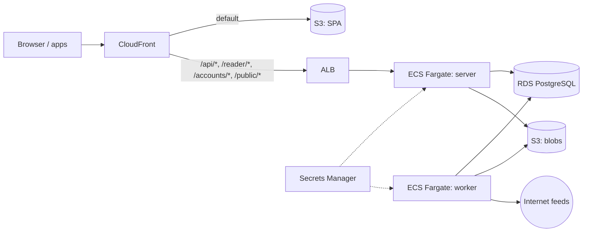

# Architecture

## Stack

| Concern | Choice |
|---|---|
| Language/runtime | TypeScript 6.0 (strict, ESM, erasable syntax only), Node 24 LTS running `.ts` directly via native type stripping (no build step for Node packages), pnpm workspaces |
| HTTP server | Fastify 5, Zod type provider, `@fastify/swagger` (OpenAPI) |
| Database | PostgreSQL 18; Drizzle ORM; drizzle-kit SQL migrations |
| Jobs | pg-boss |
| HTTP client | undici |
| Feed parsing | `feedsmith` or `@rowanmanning/feed-parser` (chosen by spike against fixture corpus) |
| Content | sanitize-html; `@mozilla/readability` + linkedom |
| Auth | `@node-rs/argon2`, `otpauth` |
| Logging | Pino (JSON) |
| Web | Vue 3, Vite, Vuetify 3, Pinia, Vue Router, TanStack Vue Query, vue-i18n |
| Desktop | Electron, electron-vite, electron-builder |
| Mobile | Capacitor |
| Tests | Vitest, Testcontainers (Postgres), Playwright |
| Infrastructure | AWS CDK (TypeScript) |

## Repository layout

Workspace packages exist only where runtime or toolchain differs.

| Path | Contents |
|---|---|
| `server/` | Everything that runs in the server image (Node) |
| `web/` | Vue SPA (PWA), built by Vite |
| `desktop/` | Electron shell around the web build |
| `mobile/` | Capacitor shell around the web build |
| `shared/` | Zod schemas, API types, typed API client (browser and Node) |
| `infra/` | CDK app |
| `docker/` | Dockerfile, `compose.yaml`, `.env.example`, reverse-proxy examples |

`server/src` layers. ESLint enforces the allowed imports.

| Folder | Contents | May import |
|---|---|---|
| `core` | Domain services (feeds, entries, filters, search, auth) and port interfaces; no framework or cloud SDK imports | `db`, `shared` |
| `db` | Drizzle schema and migrations | `shared` |
| `adapters` | Port implementations (pg-boss, local FS, S3, SSE, …) | `core`, `db`, `shared` |
| `api` | Native REST, TTRSS-compatible and Google Reader routes, SSE endpoint | `core`, `db`, `shared` |
| `importer` | TTRSS importer | `core`, `db`, `shared` |
| `entrypoints` | `server`, `worker`, `migrate`, `cli` — wire adapters into core | anything |

## Runtime model

One container image, role selected by command: `server`, `worker`, `migrate`, `cli`.

Rules:
- Server is stateless; sessions live in Postgres.
- No local-disk state outside `BlobStore`.
- Migrations run as a one-shot `migrate` command, guarded by a Postgres advisory lock.
- `buildApp()` constructs the Fastify app without listening, so it can be mounted by `listen()` or a Lambda adapter.
- The SPA is a standalone static build and talks only to the API.
- Clients treat realtime as optional and poll counters when no stream is available.

### Ports

| Port | Responsibility | Self-hosted | AWS (Fargate) | AWS (Lambda) |
|---|---|---|---|---|
| `JobQueue` | Enqueue and consume jobs with retries | pg-boss | pg-boss | SQS |
| `Scheduler` | Periodically dispatch due feeds and purges | In-process timer in worker | In-process timer in worker | EventBridge Scheduler |
| `BlobStore` | Favicons, cached images | Local volume | S3 | S3 |
| `Realtime` | Push counter/entry events to clients | SSE | SSE | None (client polling) |
| `Config` | Settings and secrets | Environment | Environment from Secrets Manager | Environment from Secrets Manager |

## Ingest pipeline

```
Scheduler ─▶ fetch job per due feed source
  fetch      conditional GET; timeout, size and redirect limits; SSRF guard; per-host concurrency; backoff; Retry-After
  parse      → normalised entries
  dedupe     by GUID, else hash(link + title); updated entries replace content when hash changes
  sanitise   allow-list HTML; resolve relative URLs
  transform  hook: readability, site rewrites
  store      insert/update entry, enclosures
  fan out    one user_entry per subscriber (unread)
  filter     each subscriber's filters, in order, until "stop"
  notify     Realtime counter events per affected user
```

Internal hooks: `beforeIngest`, `transformContent`, `afterIngest`, `renderArticle`. Readability, image proxy rewriting, and tracking-pixel stripping are implemented as hook modules.

## Data model

Shared rows are stored once per instance; per-user rows carry `user_id`. Every mutable table has `updated_at`; deletions of syncable rows are recorded as tombstones for incremental sync.

| Entity | Scope | Notes |
|---|---|---|
| `users` | Instance | Login (unique), Argon2id hash, role (`admin`/`user`), TOTP secret, disabled flag |
| `sessions` | User | Token hash, kind (`cookie`/`bearer`), user agent, last seen, expiry |
| `app_passwords` | User | Name, hash, last used |
| `user_prefs` | User | Typed key/value |
| `categories` | User | Self-referencing tree (`parent_id`), order |
| `feed_sources` | Shared | Unique normalised URL; fetch state (ETag, Last-Modified, next fetch, error count, last error); site URL; favicon ref. Fetch interval is the shortest among its subscribers; subscriptions with HTTP-auth credentials get a dedicated source |
| `subscriptions` | User | → feed source, category; title override, interval and purge overrides, per-feed options, encrypted HTTP-auth credentials. Unique (user, feed source) |
| `entries` | Shared | → feed source; GUID, link, title, author, content, content hash, published/updated times, language, `tsvector` (generated, GIN index). Unique (feed source, GUID) |
| `enclosures` | Shared | → entry; URL, MIME type, length, dimensions |
| `user_entries` | User | → entry, subscription (nullable when archived) or archived feed; unread, starred, published, score, note, read time, share UUID. Unique (user, entry) |
| `archived_feeds` | User | Title and URL of an unsubscribed feed that still holds kept entries |
| `labels` / `entry_labels` | User | Caption, colours; many-to-many with `user_entries` |
| `tags` | User | (user entry, tag) pairs |
| `filters` / `filter_rules` / `filter_actions` | User | Ordered filters; match any/all, inverse, enabled; rules: field (title, content, title-or-content, author, link, tag), regex, inverse, scope (feeds/categories); actions: type + parameter |
| `access_keys` | User | Secret keys for published feed and generated feeds |
| `import_map` | Instance | (source system, source table, source id) → new id |

Key indexes:
- `user_entries (user_id, unread)`, partial indexes on `starred` and `published`.
- `user_entries (subscription_id, …)` for feed views.
- `entries (feed_source_id, published_at DESC)`.

Headline lists use keyset pagination on (sort key, id).

## Authentication

| Client | Credential | Notes |
|---|---|---|
| Web | httpOnly, SameSite=Lax session cookie | CSRF token on state-changing requests; TOTP at login when enabled |
| Electron / Capacitor | Bearer session token | Stored in OS secure storage (Electron `safeStorage`, platform keystore on mobile) |
| TTRSS / Google Reader clients | App password → API session | App passwords bypass TOTP |

Login is rate limited per IP and per account.

## APIs

| Surface | Path | Notes |
|---|---|---|
| Native REST | `/api/v1/*` | OpenAPI at `/api/v1/openapi.json`; incremental sync via `since`/cursor |
| Events | `/api/v1/events` | SSE: counters, new entries, state changes |
| Public | `/public/*` | Published feeds and share links (no auth, secret key/UUID) |
| TTRSS-compatible | `/api/` (POST JSON `op`) | See below |
| Google Reader | `/accounts/ClientLogin`, `/reader/api/0/*` | See below |

### TTRSS-compatible API

- Operations: `login`, `logout`, `isLoggedIn`, `getApiLevel`, `getVersion`, `getUnread`, `getCounters`, `getFeeds`, `getCategories`, `getFeedTree`, `getHeadlines`, `getArticle`, `updateArticle`, `catchupFeed`, `updateFeed`, `getConfig`, `getPref`, `getLabels`, `setArticleLabel`, `shareToPublished`, `subscribeToFeed`, `unsubscribeFeed`.
- Special feed IDs:
  - `-1` starred
  - `-2` published
  - `-3` fresh
  - `-4` all
  - `-6` recently read
  - `0` archived
- Labels are exposed as feed ID `-1025 - label_id`.
- `sid` maps to an API session; login accepts app passwords only.

### Google Reader API

- Auth: `ClientLogin` with app password → `Auth` token; `/reader/api/0/token` for write tokens.
- Endpoints:
  - `user-info`, `subscription/list`, `subscription/edit`, `subscription/quickadd`, `subscription/export`
  - `tag/list`, `unread-count`
  - `stream/contents`, `stream/items/ids`, `stream/items/contents`
  - `edit-tag`, `rename-tag`, `disable-tag`, `mark-all-as-read`
- Item IDs: long form `tag:google.com,2005:reader/item/<16 hex>` and decimal short form, both derived from `user_entries` ID.
- Streams:
  - `user/-/state/com.google/reading-list`
  - `user/-/state/com.google/starred`
  - `user/-/state/com.google/read`
  - `user/-/label/<category or label>`
  - `feed/<url>`

## Deployment

### Self-hosted

`docker/compose.yaml`:

| Service | Image | Notes |
|---|---|---|
| `db` | `postgres:18-alpine` | Named volume |
| `migrate` | app image, `migrate` | Runs to completion before `server`/`worker` start |
| `server` | app image, `server` | Serves API and SPA; behind the user's reverse proxy for TLS |
| `worker` | app image, `worker` | Jobs and scheduler |
| `backup` (optional) | `postgres:18-alpine` | Scheduled `pg_dump` to a volume |

### AWS



- CDK stacks:
  - `Network`: VPC, public subnets
  - `Data`: RDS, blob bucket
  - `App`: ECR, ECS cluster, services, ALB
  - `Edge`: CloudFront, SPA bucket, certificate
- Stages: `dev`, `prod`.
- Fargate tasks run ARM64 in public subnets with public IPs (no NAT gateway). Security groups:
  - RDS accepts traffic only from tasks.
  - ALB accepts traffic only from the CloudFront prefix list.
- The SPA bucket is private, accessed via Origin Access Control. Image-proxy responses are cached at CloudFront.
- Migrations run as a one-off ECS task before the service update.
- Logs go to CloudWatch.
- Web traffic is same-origin through CloudFront. CORS allows Capacitor origins only.

### Lambda variant constraints

- SSE is not supported through API Gateway; clients poll.
- Lambda responses are capped at 6 MB; the image proxy must sit behind CloudFront caching.
- Lambdas in a VPC need NAT (or a NAT instance) to fetch feeds.
- Connection pooling requires RDS Proxy or the Aurora Data API.
