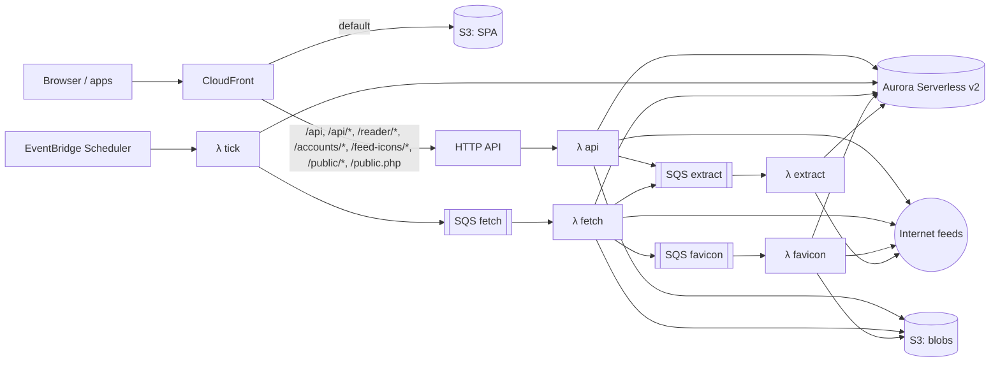

# Architecture

## Stack

| Concern | Choice |
|---|---|
| Language/runtime | TypeScript 6.0 (strict, ESM, erasable syntax only), Node 24 LTS running `.ts` directly via native type stripping (no build step for Node packages), pnpm workspaces |
| HTTP server | Fastify 5, Zod type provider, `@fastify/swagger` (OpenAPI) |
| Database | PostgreSQL 18; Drizzle ORM; drizzle-kit SQL migrations |
| Jobs | pg-boss (Docker), SQS (AWS) |
| HTTP client | undici |
| Feed parsing | `feedsmith` (RSS, Atom, RDF, JSON Feed, OPML); `htmlparser2` for feed autodiscovery |
| Content | sanitize-html; `@mozilla/readability` + linkedom |
| Auth | `@node-rs/argon2`, `otpauth` |
| Logging | Pino (JSON) |
| Web | Vue 3, Vite, Vuetify 3, Pinia, Vue Router, TanStack Vue Query, vue-i18n |
| Desktop | Electron, electron-vite, electron-builder |
| Mobile | Capacitor |
| Tests | Vitest, Testcontainers (Postgres), Playwright, axe-core (WCAG 2.2 AA scans in the Playwright suite) |
| Infrastructure | AWS CDK (TypeScript) |
| CI/CD | CDK Pipelines (CodePipeline + CodeBuild) defined in `infra/`; no GitHub workflows |

## Repository layout

Workspace packages exist only where runtime or toolchain differs.

| Path | Contents |
|---|---|
| `server/` | Server code: Docker image roles and Lambda handlers (Node) |
| `web/` | Vue SPA (PWA), built by Vite |
| `desktop/` | Electron shell around the web build |
| `mobile/` | Capacitor shell around the web build |
| `shared/` | Zod schemas, API types, typed API client (browser and Node) |
| `infra/` | CDK app: stage stacks and per-stage pipelines |
| `docker/` | Dockerfile, `compose.yaml`, `.env.example`, reverse-proxy examples |

`server/src` layers. ESLint enforces the allowed imports.

| Folder | Contents | May import |
|---|---|---|
| `core` | Domain services (feeds, entries, filters, search, auth) and port interfaces; no framework or cloud SDK imports | `db`, `shared` |
| `db` | Drizzle schema and migrations | `shared` |
| `adapters` | Port implementations (pg-boss, local FS, S3, SSE, …) | `core`, `db`, `shared` |
| `api` | Native REST, TTRSS-compatible and Google Reader routes, SSE endpoint | `core`, `db`, `shared` |
| `importer` | TTRSS importer | `core`, `db`, `shared` |
| `entrypoints` | `server`, `worker`, `migrate`, `cli`, and `lambda/` handlers — wire adapters into core | anything |

## Runtime model

- Docker: one container image, role selected by command: `server`, `worker`, `migrate`, `cli`.
- AWS: Lambda handlers `api`, `tick` (dispatch, purge, auth prune), `fetch`, `favicon`, `extract`, `migrate`, bundled by esbuild; each reads the database password parameter once per cold start.

Rules:
- Server is stateless; sessions live in Postgres.
- No local-disk state outside `BlobStore`.
- Migrations run as a one-shot `migrate` command (on AWS, a function invoked before each deployment's functions update), guarded by a Postgres advisory lock.
- Database connections time out after 10 s and idle transactions after 60 s. The server role also limits statements to 30 s and lock waits to 10 s, so requests fail instead of hanging.
- The server logs a warning, with pool usage and the longest event-loop delay, for responses slower than 2 s and for requests the client abandons before a response.
- `buildApp()` constructs the Fastify app without listening, so it can be mounted by `listen()` or a Lambda adapter.
- The SPA is a standalone static build and talks only to the API.
- Clients treat realtime as optional and poll counters when no stream is available.

### Ports

| Port | Responsibility | Self-hosted | AWS |
|---|---|---|---|
| `JobQueue` | Enqueue and consume jobs with retries; optional dedupe by key | pg-boss | SQS (no dedupe), consumed by Lambda |
| `Scheduler` | Periodically dispatch due feeds and purges | In-process timer in worker | EventBridge Scheduler |
| `BlobStore` | Favicons, cached images | Local volume | S3 |
| `Realtime` | Publish per-user invalidation events from any process; server streams them to clients over SSE | Postgres LISTEN/NOTIFY | None: the stream answers 204 and clients poll |
| `Config` | Settings and secrets | Environment | Environment and SSM Parameter Store |
| `Logger` | Structured logs | Pino | Pino |

## Web app

| Folder (`web/src`) | Contents |
|---|---|
| `views` | Route pages: login, signed-in layout (feed tree drawer, dialogs), reader, settings |
| `components` | Reader (tree, headlines, combined list, article), dialogs, settings panels |
| `composables` | Server state (TanStack Query), live counters, shortcuts, session |
| `lib` | Pure logic: stream keys, tree building, shortcut matching, reordering, cache patches |
| `stores` | Pinia store for UI state only (drawer, dialogs, notices) |

- Routes: `/login`, `/settings/:tab`, `/:stream/:entry?`. Streams are `all`, `fresh`, `starred`, `published`, `read`, `f<subscription>`, `c<category>` (`c0` uncategorised), `l<label>`, `t<tag>` (URL-encoded); search is `?q=`.
- Server data lives in the TanStack Query cache. State changes patch every cached copy, then save; a failure restores the previous flags. Headline lists are not refetched when entries change state, so read entries stay in place until the list is reloaded.
- Entries scored above the user's `scoreHighlightAbove` get a highlight bar and a bold score.
- Opening an entry marks it read once. Combined layout can mark entries read as they scroll above the top, saved in one request per second.
- Counters refetch on `counters` events. Without a stream they are polled every 60 s, paused while the page is hidden; a closed stream is retried every 5 minutes.
- Below 900 px one pane shows at a time; below 700 px secondary toolbar actions move into a menu.
- Reading preferences (font, text size, line width) set CSS custom properties on the document root that article styles read. Fonts are system font stacks, so nothing is downloaded.
- Shortcuts follow TTRSS's defaults, including two-key chords (`g a`) with a 1.5 s window. They are ignored in text fields and while a dialog is open.
- The `shortcutBindings` preference holds only changed actions; each replaces that action's defaults, and `[]` unbinds it. A key cannot be bound alone while it starts a chord.
- PWA: the service worker precaches the app shell only; API requests always go to the network.
- Every response carries `X-Content-Type-Options: nosniff`, and HSTS (1 year) when the request arrived over HTTPS; API responses default to `Cache-Control: no-store`. On AWS, CloudFront also adds HSTS to every response and a viewer-response function adds `charset=utf-8` to text responses from S3.
- In the Docker image the server serves the build from `WEB_DIR`, with a CSP (scripts from self only, frames from the sanitiser's video hosts), `Referrer-Policy: no-referrer`, and immutable caching of fingerprinted assets. Unknown non-API GETs return `index.html`. On AWS, CloudFront serves the build from S3 with the same headers, and a viewer-request function maps extensionless paths to `index.html`.

## Ingest pipeline

```
Scheduler ─▶ claim due sources ─▶ feed.fetch job per host (≤ 20 sources, fetched one after another)
  fetch      conditional GET (ETag/Last-Modified); per host at most 2 concurrent requests, starts ≥ 1 s apart
  decode     bytes → text; charset from BOM, then HTTP Content-Type, then XML declaration/HTML meta, else UTF-8
  parse      feedsmith → per-format mapping to normalised entries; XML that fails to parse is a fetch error
             dates parsed leniently, zone-less dates are UTC, unparseable dates are null
             entry links, enclosures, and site URLs kept only if absolute http(s)
  identify   feed GUID, else sha256(link + title), else sha256(content); duplicates within a document dropped
             a new item takes over an imported entry (GUID `ttrss:…`) with the same link in the same source
  sanitise   allow-list HTML; strip control characters; resolve relative URLs (incl. srcset); drop tracking pixels
             (1×1 images, images from hosts in `trackers.ts`); titles to plain text
  store      insert new entries; rewrite existing ones only when their content hash changed; replace enclosures
  fan out    new entries become unread user entries for every subscription, unless older than its purge age
             the entry's feed categories become the subscriber's tags
  filter     each recipient's enabled filters, in order, until "stop" (see Filters)
  notify     Realtime `counters` event per user who received entries
  full text  `entry.extract` job for the source when a subscriber opted in and entries were added
  schedule   next fetch after the interval, or after backoff on failure; favicon refresh when older than 30 days
```

Updater:
- Dispatch claims due sources with `FOR UPDATE SKIP LOCKED`, at most 20 per host, pushing their next fetch 15 minutes out, so concurrent dispatchers never double-fetch. A finished fetch sets the real next time.
- One `feed.fetch` job per host may wait in the queue; sources that cannot join it stay due for the next dispatch.
- The base interval is the shortest among subscribers, each taking the subscription's override, else the user's `updateIntervalMinutes` preference, else `FEED_UPDATE_INTERVAL_MINUTES`; never below 5 minutes. Users and subscriptions cannot set less than 15 minutes.
- The next fetch waits the base interval or the publisher's hint (Cache-Control `max-age`/`Expires`, RSS `ttl`, `sy:updatePeriod`), whichever is longer, hints capped at 24 h, plus up to 10 % random jitter.
- `sort_at` is the published time (fetch time when absent), clamped to now.
- A failed fetch waits interval × 2^(failures − 1), capped at 24 h and never less than `Retry-After`. HTTP 410, or `FEED_DISABLE_AFTER_FAILURES` consecutive failures, disables the source.
- `Retry-After` (and HTTP 429 without it: 10 minutes) sets the source's `blocked_until`. A 429, or a 503 with `Retry-After`, also pauses every source on that host until then (`fetch_hosts`, shared by all processes), without counting failures.
- "Update now" clears errors, re-enables the source, and enqueues a fetch. It is a no-op within a minute of the last fetch and refused (`throttled`) while `blocked_until` is in the future.
- A permanent redirect (301/308 from the first hop on) moves the source to the new URL after a successful fetch, unless another source already has that URL.
- Image proxy (per-user `proxyImages` preference): when an entry is served to such a user, `img` `src`/`srcset`, picture `source` `srcset`, and video `poster` URLs become `/api/v1/images/<hmac>/<base64url URL>`, signed with the `image-url` key. The route needs no session; it refuses unsigned URLs, then serves from `BlobStore` (`images/<sha256 of URL>`) or fetches once through `HttpFetcher` within the per-host limits and host pauses, up to 4 MB, accepting only images (declared or sniffed). Failures are not retried for 24 h. Responses are `public, max-age` 30 days, immutable, with a sandboxing CSP.
- Favicons: declared `<link rel="icon">`/`apple-touch-icon`, else `/favicon.ico`; the first 3 candidates only; page read up to 512 KB, icons up to 256 KB; reused from another source of the same site checked within 30 days instead of refetched; share the per-host limits; stored in `BlobStore`; served with a sandboxing CSP.

Purge (every 6 h):
- Deletes user entries older than the purge age: the subscription's `purge_days`, else the user's `purgeDays` preference, else `FEED_PURGE_DAYS`; 0 never. Kept entries (starred, published, noted, labelled, or shared) are never purged.
- Deletes entries no user references once they have been absent from their feed for 7 days (`last_seen_at`), so purged entries are not re-ingested as new.
- Deletes feed sources with no subscriptions and no kept entries, and their favicons.
- Deletes proxied images and remembered failures fetched more than 30 days ago.
- Deletes tombstones older than 30 days, and expired host pauses.

Fetching untrusted URLs (`HttpFetcher`):
- http(s) only, at most 5 redirects, a 20 s timeout, and a 10 MB body limit (lower per request where less is needed); downloads stop once the limit is exceeded. Responses are decompressed.
- Private, loopback, link-local, multicast, documentation, and IPv4-embedding IPv6 (NAT64, 6to4, Teredo) addresses are refused unless allowed by `FETCH_ALLOW_PRIVATE_NETWORKS`. The check runs on the resolved address at connect time, which also covers redirects and DNS rebinding.
- Subscribe errors name the failure class (private network, HTTP status, too large, unreachable), never the network error text.

Subscription lifecycle:
- Subscribing normalises the URL. An existing feed source is reused without fetching. Otherwise the URL is fetched and must parse as a feed, or be an HTML page whose `<link rel="alternate">` names exactly one feed; several feeds are returned for the user to choose.
- Subscribing to a new source ingests the response that validated it, so the feed is not fetched twice. OPML import creates sources and subscriptions only; their entries arrive with the first scheduled fetch. Subscribing to a source that already has entries delivers those within the purge window immediately.
- Unsubscribing deletes the user's entries from that feed except kept ones, which stay with no subscription. Feed sources without subscriptions are left for purge.
- Deleting a category moves its feeds and child categories to its parent.
- OPML import reuses categories with the same name and parent, and existing subscriptions, so re-importing is a no-op. It skips TTRSS's `tt-rss-prefs`, `tt-rss-labels`, and `tt-rss-filters` outlines.

Full text:
- `entry.extract` jobs (one per feed source at a time) take the source's 20 newest entries not tried yet, newest first, and fetch each linked page through the per-host limits (HTML only, at most 5 MB). Readability (`@mozilla/readability` on linkedom) extracts the article, which is sanitised like feed content and stored in `entries.full_content`. Failures are recorded in `full_content_error` and not retried by jobs.
- `POST /api/v1/entries/:id/full-text` extracts on demand, retrying earlier failures, and returns the stored text when there is one.
- Readers see the full text first for subscriptions opted in to it, with a toggle back to the feed's content, and on request for others. TTRSS and Google Reader clients get it in place of the content for opted-in subscriptions. The original content is always kept, and search indexes it only.

## Data model

Shared rows are stored once per instance; per-user rows carry `user_id`. Every table synced to clients has `updated_at`, maintained by a database trigger. Statement-level triggers record deletions of categories, subscriptions, labels, and user entries as tombstones for incremental sync. Assigning or removing a label or tag touches the user entry, so sync carries its label ids and tags; tags copied at fan-out do not.

| Entity | Scope | Notes |
|---|---|---|
| `users` | Instance | Login (unique), Argon2id hash, role (`admin`/`user`), disabled flag; sealed TOTP secret, enabled time, last accepted time step |
| `recovery_codes` | User | SHA-256 hash, used time |
| `sessions` | User | Token hash, kind (`cookie`/`bearer`/`api`), user agent, app password (`api` only), last seen, expiry |
| `app_passwords` | User | Name, hash, last used |
| `image_cache` | Instance | Blob key, fetch time, size, failed flag |
| `user_prefs` | User | One row per changed preference (JSON value); unset keys take the defaults in `shared` |
| `categories` | User | Self-referencing tree (`parent_id`), order |
| `feed_sources` | Shared | Unique normalised URL; fetch state (ETag, Last-Modified, next fetch, error count, last error, publisher TTL hint, `blocked_until`); site URL; favicon ref. Fetch interval is the shortest among its subscribers; subscriptions with HTTP-auth credentials get a dedicated source |
| `subscriptions` | User | → feed source, category; title override, interval and purge overrides, full-text opt-in, per-feed options, encrypted HTTP-auth credentials. Unique (user, feed source) |
| `entries` | Shared | → feed source; GUID, link, title, author, content, content hash, extracted full text (with attempt time and error), published/updated times, language, normalised feed categories, `tsvector` (generated, GIN index). Unique (feed source, GUID) |
| `enclosures` | Shared | → entry; URL, MIME type, length, dimensions |
| `user_entries` | User | → entry, subscription (nullable when archived) or archived feed; unread, starred, published, score, plain-text note (null when none), read time, share UUID. Unique (user, entry) |
| `archived_feeds` | User | Title and URL of an unsubscribed feed that still holds kept entries |
| `labels` / `entry_labels` | User | Caption (unique per user, case-insensitive), text and background colours (`#rrggbb`); many-to-many with `user_entries` |
| `entry_tags` | User | (user entry, tag) pairs; tags are lower-case, single-spaced, without commas, at most 64 characters and 50 per entry |
| `filters` / `filter_rules` / `filter_actions` | User | Ordered filters; match any/all, inverse, enabled; rules: field (title, content, title-or-content, author, link, tag), RE2 pattern, inverse, scope (subscription and category id arrays; empty for all feeds); actions: type with a label, tag, or score |
| `access_keys` | User | Secret keys for published feed and generated feeds |
| `import_map` | Instance | (TTRSS table, source id) → new id and owning user; on user rows, when that user's last import finished |

Key indexes:
- `user_entries (user_id, unread)`, partial indexes on `starred` and `published`.
- `user_entries (subscription_id, …)` for feed views.
- `entries (feed_source_id, published_at DESC)`.

Headline lists use keyset pagination on (sort key, id). `user_entries.sort_at` is a denormalised copy of the entry's published time (fetch time when absent), so every headline view is served by one index. Descending index columns are `NULLS LAST`; queries order the same way so the indexes apply.

Search:
- A generated `tsvector` (`simple` configuration, markup stripped) on `entries`; queries use `websearch_to_tsquery` (quotes, `OR`, `-`).
- The user's notes match too, through a partial GIN index on `to_tsvector('simple', note)`. Notes do not count towards the 20,000 below.
- A query matching at most 20,000 entries instance-wide (counted from the GIN index) is resolved into a materialised set of the user's matches, then sorted. A more common one walks the headline index, where matches are dense.
- Relevance order ranks (`ts_rank`) the 1,000 most recent matches and pages by offset.

## Authentication

| Client | Credential | Notes |
|---|---|---|
| Web | httpOnly, SameSite=Lax session cookie | CSRF token on state-changing requests; TOTP at login when enabled |
| Electron / Capacitor | Bearer session token | TOTP at login when enabled; stored in OS secure storage (Electron `safeStorage`, platform keystore on mobile) |
| TTRSS / Google Reader clients | App password → `api` session | App passwords bypass TOTP |

- Session tokens are 256-bit random values stored as SHA-256 hashes. Cookie sessions last 30 days, bearer and `api` sessions 90 days, all sliding on use. Logging in ends the session the client sent, if any.
- `api` sessions are opened only by an app-password login through a compatibility API and belong to that app password: revoking it ends them, and each keeps its 10 most recent. `/api/v1` ignores them; the compatibility APIs accept nothing else.
- The cookie is `__Host-rss_session` (Secure) over HTTPS and `rss_session` over plain HTTP; HTTPS is taken from `X-Forwarded-Proto` only when `TRUST_PROXY` trusts the proxy.
- A user created with a generated password (the AWS bootstrap admin) has `password_change_required`: until they change it, every authenticated request other than session, login, logout, and password change gets 403 `password_change_required`, and the web app shows only the password change.
- Cookie-session requests other than GET/HEAD/OPTIONS must send the session's CSRF token in `X-CSRF-Token`. Login accepts JSON only, so cross-site form posts cannot log a browser in.
- Failed logins are counted in `login_attempts` per account (lockout after 5) and per IP (after 20). Lockouts start at 1 s and double per further failure, up to 15 minutes. A wrong current password when changing it counts against the account. A lockout only delays further password, code, and app-password checks for that account or IP; signed-in sessions keep working, so an attacker can at worst hold off new sign-ins 15 minutes at a time.
- Passwords are 8–1,024 characters and not on the bundled common-password list (the 10,000 most frequent of 8+ characters, `shared/src/common-passwords.ts`).
- Logins, failures, lockouts, CSRF rejections, password changes, session revocations, and admin user changes are logged with a `security` field naming the event. The logger redacts credentials and auth headers.
- TOTP (RFC 6238: SHA-1, 6 digits, 30 s, ±1 step) is optional per user. With it on, a correct password returns a signed 5-minute challenge instead of a session; `POST /auth/login/2fa` exchanges it with a TOTP code or one of 10 single-use recovery codes. A code from a time step at or before the last accepted one is refused. Code failures count against the account and IP like password failures.
- Starting enrolment and turning 2FA off re-check the password; turning off and regenerating recovery codes need a code. Enabling 2FA signs out the user's other sessions. Admins (`POST /admin/users/:id/2fa/reset`) and `cli user reset-2fa` turn it off and sign the user out everywhere.
- App passwords are 160-bit random values shown once (`xxxx-xxxx-…`; case and dashes ignored), stored as SHA-256 hashes, at most 50 per user. Creating one re-checks the account password. `AuthService.authenticateAppPassword` is the only check that accepts them: it skips TOTP, refuses account passwords, shares the login throttle, and records last use at most hourly. `/auth/login` never accepts them. An admin password reset revokes them; a disabled user's are refused.
- Changing or resetting a password, or disabling a user, revokes their other sessions. The last active admin cannot be demoted, disabled, or deleted.
- `APP_SECRET` (Docker env; SSM `app-secret` on AWS) is the root of per-purpose keys derived with HKDF-SHA256 (`server/src/core/crypto.ts`). Stored secrets are sealed with AES-256-GCM as `v1.<iv>.<ciphertext>.<tag>`, authenticated against their owning row; tokens are signed with HMAC-SHA256. A new secret voids every sealed value and signature; there is no rotation.

## APIs

| Surface | Path | Notes |
|---|---|---|
| Native REST | `/api/v1/*` | OpenAPI at `/api/v1/openapi.json`; typed client in `shared` |
| Server info | `/api/v1/server` | Product, build, and API version; no session |
| Events | `/api/v1/events` | SSE: `counters` invalidation events |
| Images | `/api/v1/images/<hmac>/<url>` | Proxied entry images; signed, no session |
| Public | `/public/*` | Published feeds and share links (no auth, secret key/UUID) |
| TTRSS-compatible | `/api/`, `/api/index.php` (POST, `op`) | See below |
| TTRSS feed icons | `/feed-icons/<user segment>/<id>.ico` | Signed per-user path, no session; see below |
| Google Reader | `/accounts/ClientLogin`, `/reader/api/0/*`; also under `/api/greader.php` | See below |

### Native REST API

- `GET /server` returns the product (`rss-reader`), the server build (`RSS_READER_VERSION`: the commit on AWS, a Docker build argument, else `dev`), and the API version (`API_VERSION` in `shared`). A new major breaks existing apps; a new minor adds endpoints apps may require. Users who must change their password can still reach it.
- CORS on `/api/v1/*` allows the app origins `app://rss-reader` (Electron) and `https://localhost` (Capacitor Android): requests with `Authorization` and `Content-Type`, `Retry-After` exposed, preflights cached for a day. Credentials are never allowed, so apps use bearer tokens and cookie sessions stay same-origin. Other origins get no CORS headers. CORS is applied before authentication, so apps can read errors too.
- Entries are identified by `user_entries.id`. A headline list selects one stream: a subscription, a category (with subcategories; `0` is uncategorised), a label, a tag, or a special feed (`all`, `fresh`, `starred`, `published`, `recentlyRead`).
- Fresh: unread entries with `sort_at` within the user's `freshMaxAgeHours`. Recently read: entries read within the last 7 days, in reading order.
- Scores are whole numbers within ±1,000,000, set with the entry's flags. Entries scored below the user's `scoreHideBelow` are left out of subscription, category, All, and Fresh lists and unread counts; Starred, Published, label, tag, and Recently read lists show them, and catch-up marks them read.
- `adaptive` view resolves to `unread` when the stream has unread entries, else `all`; the cursor carries the resolved view.
- State changes and catch-up publish `counters`; rows already in the requested state are not updated.
- `GET /sync` returns categories, subscriptions, labels, and entries (without content) changed since a token, and deleted ids. Each call only covers changes before the start of the oldest transaction still open in the database, so rows committed late are never skipped. Entries page by (`updated_at`, id); `more` asks for another call. Tokens older than the 30-day tombstone retention get `410 resync_required`.

Filters:
- Patterns are RE2 syntax (re2js), matched case-insensitively and in linear time; patterns RE2 cannot compile are refused when saved.
- `content` rules match the stored HTML; `tag` rules match each tag; a category scope includes its subcategories.
- Enabled filters run in order on each user entry as it is delivered (fetch and new-subscription backfill), in the same transaction, until a `stop` action. Matching filters' actions combine: delete wins, scores add up within ±1,000,000, labels and tags accumulate (at most 50 tags).
- `POST /filters/test` checks a draft against the user's 1,000 most recent entries and returns up to 50 matches. `POST /filters/:id/apply` runs one saved filter over existing entries, newest first, for at most 15 s per call, returning a cursor to continue; it never deletes kept entries (starred, published, noted, labelled, shared).

Events stream:
- Events are per-user invalidation signals; clients refetch what they describe. Events of one type within 1 s are sent once.
- `X-Accel-Buffering: no` disables nginx buffering; a comment line every 25 s keeps proxies from timing out; streams end after 30 minutes and clients reconnect, which re-checks the session.

### Public pages

- `/public/share/<uuid>`: a shared entry as a server-rendered HTML page. `user_entries.share_id` is a random UUID set when the user shares the entry and cleared when they revoke it.
- `/public/feeds/<key>`: RSS 2.0 of the user's 50 newest published entries, with content. The key is 32 random bytes (base64url) in `access_keys`, stored as is so the address can be shown again; regenerating replaces it.
- `/public.php?op=rss&id=-2&key=<key>` and `/public.php?op=share&key=<uuid>`, TTRSS's addresses for the same pages, redirect (301) to them; other `public.php` requests answer 404.
- The share and feed pages answer 404 for unknown ids and for disabled owners. Pages send their own CSP (no scripts, frames only from the sanitiser's video hosts), `Referrer-Policy: no-referrer`, and `X-Robots-Tag: noindex`.
- Images go through the image proxy when the owner has it on. Feed URLs are absolute, from `PUBLIC_URL`, else the request's origin.
- The feed carries a weak ETag over its items and answers `If-None-Match` with 304.

### TTRSS-compatible API

- Operations: `login`, `logout`, `isLoggedIn`, `getApiLevel`, `getVersion`, `getConfig`, `getPref`, `getUnread`, `getCounters`, `getFeeds`, `getCategories`, `getFeedTree`, `getHeadlines`, `getArticle`, `updateArticle`, `catchupFeed`, `updateFeed`, `getLabels`, `setArticleLabel`, `subscribeToFeed`, `unsubscribeFeed`. `shareToPublished` is not supported.
- Feed IDs are subscription IDs; special feed IDs:
  - `-1` starred
  - `-2` published
  - `-3` fresh
  - `-4` all
  - `-6` recently read
  - `0` archived (empty)
- Category IDs are category IDs; `0` uncategorised, `-1` special feeds, `-2` labels, `-3` all feeds, `-4` all feeds with special feeds and labels. Category streams include subcategories.
- Labels are feed ID `-1025 - label_id`, in feed lists, counters, `getLabels`, `setArticleLabel`, and each headline's `labels` (`[feed ID, caption, fg, bg]`). A non-numeric `feed_id` names a tag.
- `getHeadlines` pages by `limit` (at most 200) and `skip`; `view_mode` `unread`, `adaptive`, and `marked` (starred) apply, others list all; `order_by=date_reverse` lists oldest first; `search` uses full-text search, across all feeds with `search_mode=all_feeds`.
- `updateArticle` fields: 0 starred, 1 published, 2 unread, 3 note (`data`); modes 0 clear, 1 set, 2 toggle.
- `subscribeToFeed` codes: 0 already subscribed, 1 added (`feed_id`), 2 invalid URL, 3 no feed found, 4 several feeds found (`feeds`: URL → title), 5 fetch failed.
- `getConfig` (also `config` in the `login` answer) gives `icons_url` `feed-icons/<user segment>`: icons are served at `/feed-icons/<segment>/<subscription id>.ico`, the segment being the user ID signed with the `feed-icons` key, and only for that user's subscriptions.
- Content goes through the image proxy for users who turned it on. `getPref` answers the TTRSS preferences that have an equivalent here and `null` for others, which are logged.
- Requests are POSTs whose body is JSON, whatever its declared type, or form-encoded; query strings are ignored, so passwords never appear in logged URLs. `sid` is an `api` session token; `login` accepts app passwords only and reports API level 20.
- Every answer is HTTP 200 `{seq, status, content}`, `seq` echoing the request. Errors have status 1 and `content.error`: `NOT_LOGGED_IN`, `LOGIN_ERROR`, `API_DISABLED` (password must be changed), `UNKNOWN_METHOD` (with `method`), `INCORRECT_USAGE`, `FEED_NOT_FOUND`.

### Google Reader API

- Auth: `ClientLogin` (POST form `Email`, `Passwd`; app passwords only) answers `SID=…`, `LSID=null`, `Auth=…` lines, or 401 `Error=BadAuthentication`. Calls send `Authorization: GoogleLogin auth=<token>`; without a valid `api` session they get 401, or 403 while the password must be changed. `/reader/api/0/token` issues the `T` write token, which writes accept unchecked: header authentication leaves no cross-site forgery to prevent.
- Endpoints (JSON whatever `output` asks; writes answer `OK`; others 404):
  - `user-info`, `subscription/list`, `subscription/edit` (`subscribe`, `unsubscribe`, `edit`), `subscription/quickadd`, `subscription/export` (OPML)
  - `tag/list`, `unread-count`
  - `stream/contents` (stream in the path or `s`), `stream/items/ids`, `stream/items/contents` (`i` repeated)
  - `edit-tag`, `rename-tag`, `disable-tag`, `mark-all-as-read`
- Item IDs are `user_entries` IDs: long form `tag:google.com,2005:reader/item/<16 hex>` in items, decimal in `stream/items/ids`; requests may use either, or bare 16-digit hex.
- Streams (`user/<id>/…` is the same as `user/-/…`):

| Stream | Selects |
|---|---|
| `user/-/state/com.google/reading-list` | All |
| `user/-/state/com.google/starred` | Starred |
| `user/-/state/com.google/read` | All, read only |
| `user/-/state/com.google/broadcast` | Published |
| `user/-/label/<name>` | The folder with that name, else the tag |
| `feed/<subscription id>` | That subscription; `feed/<feed URL>` also matches |

- Folders are categories, named by their path (`Parent/Child`); tags are labels. A label whose caption equals a folder's name is hidden from the API, and tagging items with a folder's name does nothing. Tagging with an unknown name creates the label; `subscription/edit` with an unknown folder creates a top-level category.
- `it`/`xt` include or exclude the `read` and `starred` states (`kept-unread` counts as unread); `ot` and `nt` (seconds) bound the sort time, `ot` inclusive; `r=o` lists oldest first; `c` continues from a page's `continuation`.
- Page sizes: `stream/contents` default 20, at most 1,000 and within the entry list's content budget; `stream/items/ids` default 1,000, at most 10,000; `stream/items/contents` at most 1,000 ids.
- `edit-tag` adds and removes `read`, `kept-unread` (marks unread), `starred`, `broadcast` (published), and labels.
- `mark-all-as-read` marks the stream read, with `ts` (microseconds) only entries delivered to the user by then.
- Items carry `categories` with their states, folder, and tags; `origin.streamId` is the subscription; `summary.content` goes through the image proxy for users who turned it on. `subscription/list` gives `iconUrl` from the feed icon path, absolute from `PUBLIC_URL` or the request's origin.
- `quickadd` subscribes to the first feed a page advertises.

Both compatibility APIs log each unsupported call with the client's user agent. `COMPAT_TRACE` logs every call and its parameters, credentials redacted; it is on for the AWS `dev` stage.

The settings page shows apps' connection details from `/api/v1/auth/app-passwords/connection`: the server URL (`PUBLIC_URL`, else the request's origin) and the suggested sync interval, 60 minutes, so the AWS database can pause between syncs.

## Deployment

### Self-hosted

`docker/compose.yaml`:

| Service | Image | Notes |
|---|---|---|
| `db` | `postgres:18-alpine` | Named volume |
| `migrate` | app image, `migrate` | Runs to completion before `server`/`worker` start |
| `server` | app image, `server` | Serves API and SPA; behind the user's reverse proxy for TLS; `/healthz` checks database and queue |
| `worker` | app image, `worker` | Jobs and scheduler |
| `backup` (`backup` profile) | `postgres:18-alpine` | Nightly `pg_dump` to a volume |

### AWS



- Stacks per stage: `Params` (generated credentials), `Data` (VPC with public subnets only, Aurora, blob bucket), `App` (functions, HTTP API, queues with dead-letter queues, schedules, migrate trigger), `Edge` (CloudFront, SPA bucket, DNS records), all in us-east-2. CloudFront uses the existing `*.example.com` certificate in us-east-1, imported by ARN.
- Names: stacks are `rss-reader-<stage>-{params,data,app,edge,pipeline}`, and resources with settable names use `rss-reader-<stage>-<role>` (functions, log groups, queues, schedules, HTTP API, cluster, CloudFront function and policies). Bucket names are generated from the stack name. Everything is tagged `project=rss-reader` and `stage=<stage>`.
- Functions run outside any VPC, so they reach feeds without NAT. Aurora is publicly reachable on 5432 with TLS required (`rds.force_ssl`) and a generated password; it scales between 0 and 2 ACU and pauses after 5 idle minutes.
- Dispatch runs every 30 minutes; purge (every 6 h) and auth prune (hourly) fall on dispatch times, so the database wakes once per slot. One fetch invocation handles one host's batch; at most 8 run at once.
- CloudFront adds a secret `x-origin-verify` header to API requests; the API refuses requests without it.
- CloudFront does not forward the viewer's `Host`, so functions get `PUBLIC_URL` set to the stage's domain.
- `/api/v1/images/*` is cached at the edge (managed CachingOptimized policy: no cookies or viewer headers in the key, TTL from the API's `Cache-Control`); other API paths are not cached.
- Generated credentials are Standard SSM parameters under `/rss-reader/<stage>/`, created once by a custom resource in `Params` and deleted with it; `Params` deploys before `Data` because change sets resolve `ssm-secure` references: `db-password`, `admin-password`, and `app-secret` (SecureString), `origin-header` (String, because CloudFront resolves only String parameters). `TRUST_PROXY` is two hops (API Gateway appends CloudFront's address after the viewer's).
- The SPA bucket is private, accessed via Origin Access Control. `assets/` is cached as immutable; other files are revalidated, and each deployment invalidates the distribution.
- Logs go to CloudWatch, kept a month.
- Web traffic is same-origin through CloudFront. The API behaviour forwards `Origin` and `OPTIONS`, so the apps' CORS preflights reach the API; the pipeline smoke test sends one.

Constraints:
- The first request after the database pauses waits about 15 s for it to resume.
- Responses are capped at 6 MB; list pages with content end early past 2 M content characters.
- No SSE; clients poll counters every 60 s.

Operator setup, once per account:
- `pnpm --filter @rss-reader/infra cdk bootstrap aws://123456789012/us-east-2`
- `pnpm --filter @rss-reader/infra cdk deploy rss-reader-dev-pipeline` (and `rss-reader-prod-pipeline`); a new pipeline runs once on creation, and later changes deploy through it.
- The first admin is `admin`, with a generated password in the SSM SecureString `/rss-reader/<stage>/admin-password` that must be changed at first sign-in. Create a personal admin, then disable or delete `admin`.
